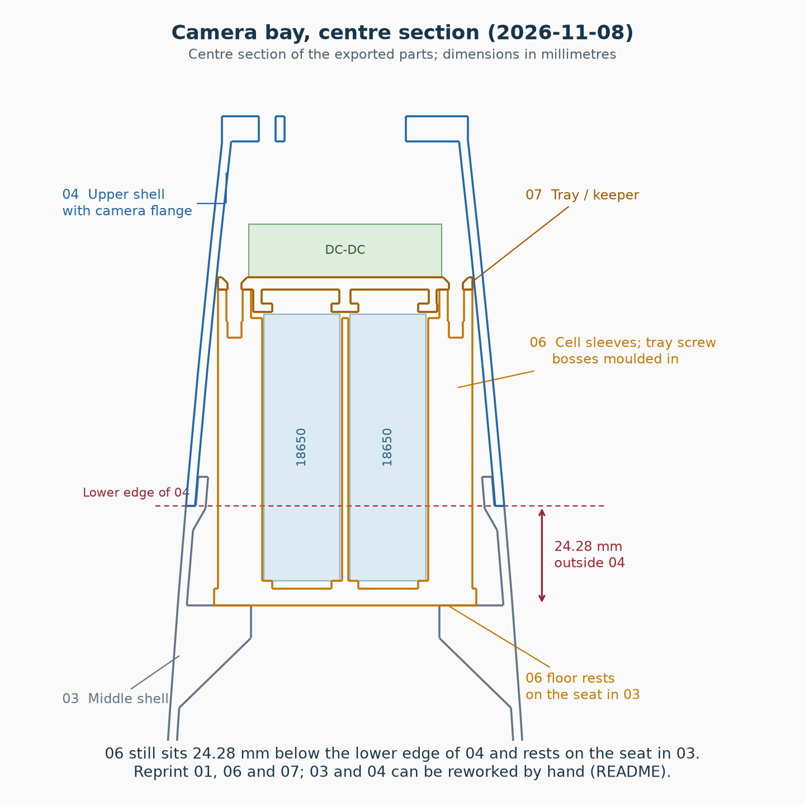
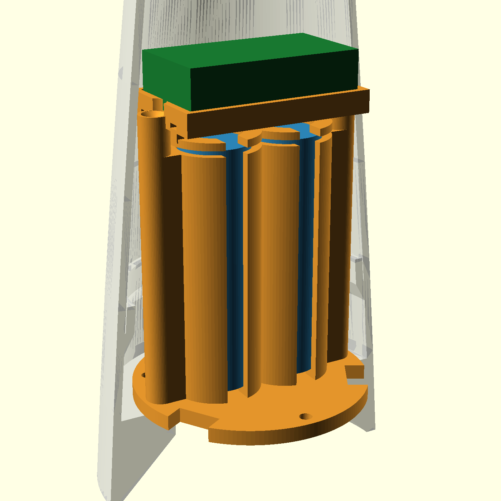

# Peregrine camera nosecone and electronics bay

Two upright tabbed 18650 cells sit below a 47 × 26 × 13 mm DC-DC converter.
The upper shell and camera adapter are **one printed part**. Three side
screws release that upper assembly for servicing; the camera remains
separately bolted to its flange. The lower slice joints stay glued.

This is a CAD-verified prototype, with the initial 04/06 trial fit reported
below. Full assembly fit, insert strength, mechanical loads, temperatures
and ejection protection have not been bench-tested.

## Revision 2026-11-08 — sleeves, insert pockets, flush screws, ribbon slots

Changes from the owner's first full print:

- **06 carrier:** the cell cups are now **full-height sleeves** and the two
  tray screw bosses are moulded into their outer ends along the whole
  height. The free-standing 8 mm posts are gone. Each sleeve has one
  full-height 6 mm slot, both on **−Y**, so a cell with soldered tabs (or a
  pair already joined at the bottom) slides in from above with its lower tab
  running down the slot.
- **07 tray:** the short cups around the cell tops are gone (the sleeves
  locate the cells); the keeper ring and its ribs remain. The bath rim is
  notched where the countersunk tray screws go in — before, the rim
  overhung each head by 1.8 mm, so the screw could not be inserted.
- **All blind heat-set pockets are 7.7 mm deep** (insert 5.7 + 2). ruthex
  specifies at least L + 1 mm; the old 5.9 mm pockets left the displaced
  plastic nowhere to go, and it ran into the thread. Tray bosses also have a
  Ø3.4 relief below the pocket for the screw tip.
- **04 top shell:** the three service-joint screws are **countersunk**, flush
  with the shell (M3 90°, head ≤6.2 mm). The seat is 1.4 mm deep in the
  2.2 mm wall — do not over-tighten.
- **01 shoulder:** each recovery slot is **T-shaped**: a 4 mm stem runs 8 mm
  from the middle of the 16 × 4 mm slot toward the axis, for a copper guide
  wire to pull the ribbon through after assembly.

**Reprint 01, 06 and 07.** The printed 03 and 04 can be reworked instead:

- 03, three floor-seat pockets (on the seat face at Z=270): drill Ø4.0 mm to
  7.7 mm deep before fitting inserts. The CAD keeps ≥1 mm of corbel under
  that depth.
- 03, three service-joint bosses: drill Ø4.0 mm to 7.7 mm deep from the
  boss face (was 6.0 mm); a Ø3.4 hole already continues beyond.
- 04, three side holes: countersink 90° to Ø6.2 mm.

02 is unchanged. The board stays with its 47 mm side along X: turned 90°,
it blocks the switch body when the top shell lifts off. CAD checks for this
revision: `sleeve-revision-verification.json` (113/113).

## Shoulder insertion chamfer and tube fit — 2026-11-03

**The owner reports four gauge bands entered, while the fifth did not:**
Ø98.9 mm entered and Ø99.1 mm did not. The current 01 therefore retains
its **Ø98.7 mm body**, 0.2 mm smaller than the largest band that entered,
to allow some margin along the 100 mm insertion length.

**Print the updated 01 bulkhead-down.** Its insertion end now starts at
Ø96.7 mm and tapers smoothly to Ø98.7 mm over the first 2 mm. This external
lead-in helps centre the shoulder and avoids a square edge catching the
tube rim. The main bore, existing internal chamfer, ribbon slots and upper
Ø96.7 × 15 mm spigot are unchanged. The already printed parts need no
reprint for this change. The full-length shoulder still needs a dry fit.

The gauge and its measured result are documented below for reference.
Current shoulder CAD checks are in `entry-chamfer-verification.json`;
Bambu Studio was not used for this revision.

### Stepped gauge

**The owner reports that the Ø99.7 mm ring does not enter the tube.**
That +1 mm trial is rejected. The tube's outside-profile difference did
not establish the inside clearance. Part 00 is now a stepped insertion
gauge spanning Ø98.3–99.1 mm in 0.2 mm increments, 15 mm tall overall.

Print it **largest end down**, as supplied. Insert the **smallest end
first**, without forcing it. From that small end, each 3 mm band is:

| Band from insertion end | Diameter | Depth reached when that band has entered |
|---|---:|---:|
| 1 | 98.3 mm | 3 mm |
| 2 | 98.5 mm | 6 mm |
| 3 | 98.7 mm | 9 mm |
| 4 | 98.9 mm | 12 mm |
| 5 | 99.1 mm | 15 mm |

The first four bands entered in the owner's trial. The tip has a 0.3 mm lead-in;
judge the full cylindrical band, not just the beveled tip. A similar relief
at the bed keeps first-layer flare away from the largest test surface.

The gauge supports retaining the original **Ø98.7 mm** shoulder body.
A short gauge does not prove that a full 100 mm-long shoulder will fit
an oval or bowed tube. Parts 02/03/04/06/07 remain unchanged.

Use the current numbered STLs. The initial Ø101.5 outside-profile ring and
the subsequent Ø99.7 insertion ring are superseded. Existing 3MF projects
contain earlier shoulder geometry; import the current STL. The gauge's
original CAD check is recorded in `fit-gauge-verification.json`.

## How 04 and 06 fit together

**06 does not go completely inside 04.** Its bottom is supposed to remain
**24.28 mm below the wide lower edge of 04**. The carrier floor sits in
**03**, which surrounds that lower portion. Insert 06 sleeves-first through
04's wide end for a trial fit; do not force the carrier floor up to the
04 rim. The screw bosses (±X) must face the shell sides away from the
switch (+Y) and charging pads (−Y). Part 07 screws to the tops of the bosses.

The owner printed 04/06/07 and reported approximately 24 mm remaining
outside, which matches this arrangement. That observation does not require
those parts to be reprinted. As of 2026-11-03, the owner has printed every
required part except 01; full assembly fit has not yet been reported.



## Recovery ribbon

The recovery strap goes through **01-Shoulder**, not through the electronics
barrier. Its two rounded slots are **16 × 4 mm**, suitable as a nominal
opening for the owner's approximately 15 mm-wide ribbon; they clear a solid
15 × 3 mm test gauge. Since 2026-11-08 each slot is **T-shaped**: a 4 mm
stem runs 8 mm from the middle of the slot toward the axis (both stems point
at each other). With the nosecone assembled, push a copper wire through the
stem, hook the ribbon, and pull it through the slot. Actual ribbon thickness
and printed clearance still need checking.

## Shoulder chamfer — 2026-11-03

The preceding chamfer revision replaced the internal ledge. The bore now
narrows gradually over 2 mm at the spigot instead of leaving a 1 mm radial
horizontal ledge. Print bulkhead-down as before. Outside mating surfaces,
115 mm total height and both 16 × 4 mm ribbon slots are unchanged; the
already printed parts need no revision for this fix.

Bambu Studio 02.08.02.61 was run on the old and new shoulder with the same
P1S/0.4 mm, 0.2 mm-layer settings and automatic tree supports enabled. The
old mesh produced support paths; the new mesh produced **zero support or
support-interface paths**. Geometry checks also confirm the unchanged fit
to 02 and clearance for a 15 × 3 mm ribbon gauge. This verifies the CAD and
sliced paths, not a physical print. See `shoulder-verification.json`.



The camera itself is the owner's existing CAD design, not the grey flange
in this view. Its mesh is on `feature/rocket60` at
`STL Files/Rocket60/NoseCone.stl`.

## Print these parts

| Part | Mesh | Height | Bed orientation |
|---|---|---:|---|
| 0 | `TestRing.stl` | 15 mm | Largest end down; five Ø98.3–99.1 fit bands |
| 1 | `Shoulder.stl` | 115 mm | Bulkhead down |
| 2 | `SliceBottom.stl` | 154.15 mm | Wide end down |
| 3 | `SliceMiddle.stl` | 154.13 mm | Wide end down; includes floor seat and service-joint bosses |
| 4 | `SliceTop.stl` | 94.95 mm | **Camera flange down**; rotate 180° about X or Y |
| 6 | `BatteryCarrier.stl` | 77 mm | Solid floor down; sleeves and bosses print upright, no supports |
| 7 | `ConverterTray.stl` | 11.4 mm | Bath opening down; rotate 180°; support under the bath floor |

**Do not print or install `Adapter.stl` with this bay top.** Part 5 is kept
only for the previous separate-adapter design (`Bay_Enabled=false`). The
new top has an integral flange, with no spigot or adapter-to-shell glue joint.

Repository meshes retain their assembly coordinates: orient, then drop to
bed. The downloadable print pack is already oriented at Z=0. Part 2 keeps
its previous shape; part 1 has both internal and entry chamfers at Ø98.7. Parts
3 and 4 replace the pre-bay versions; the owner's already printed bay
versions remain current. Part 8 is a cutaway view, not a printable part.

Use PETG or ASA as before. Start with 0.2 mm layers and at least four
perimeters; use local solid-infill modifiers for the floor, flange, screw
bosses and insert seats. Inspect the slicer's paths. Support the tray bath
floor; check whether the top shell's internal panel pads need
local support. Clear all tab reliefs and cable-tie tunnels after printing.

## Hardware

| Item | Quantity | Use |
|---|---:|---|
| ruthex RX-M3×5.7 inserts, Ø4.0 × 7.7 mm pockets | 11 | 3 camera, 3 service joint, 3 floor, 2 tray bosses |
| M3×8 button-head screws | 3 | Carrier-floor screws |
| M3×8 **90° countersunk** screws, head ≤6.2 mm | 5 | 3 shell side screws, 2 converter tray; all heads flush |
| Camera's existing M3 screws | 3 | Match actual camera base; ≤5.7 mm insert engagement |
| Schurter 0033.4513 + 0098.0043 nut | 1 each | Switch; nut may be a separate order |
| M3 countersunk screws, nuts and terminations | As wired | Three unassigned charging-contact seats |
| 2.5 mm cable ties | 2 | Converter restraint |
| Insulating liners/end pads, sealant, optional epoxy | As fitted | Insulation, floor seal, optional converter bond |

The owner supplies series wiring, charging, polarity and tab connections.
There are no battery spring contacts. The three exterior screw seats are
mechanical provisions, not a circuit or charger specification; unused
seats can be closed with insulating plugs.

## Check before the large prints

- Cell envelope: **18.5 mm wrapped diameter × 65 mm body**, excluding tabs.
  Cup ID 19.5 mm; 2 mm lower tab relief, at least 5 mm above the body,
  and 6 mm-wide exits. Measure actual cells and tabs; adjust `Bay_Cell_D`
  and `Bay_Cell_Body_L` if needed, then regenerate and recheck the model.
- The sleeves (ID 19.5 mm) locate the cells; each has a 6 mm loading slot
  on −Y. The keeper ring on 07 has 0.6 mm axial clearance, taken up with an
  insulating annular pad. Ø14.5 mm centre openings and split exits leave terminals
  accessible. Bear on the insulated rim, not solder tabs or the vent.
  Do not fill these reliefs with epoxy.
- Converter envelope: 47 × 26 × 13 mm; bath footprint 47.8 × 26.8 mm.
  Support surface Z=350. Allow at most about 1 mm adhesive underneath
  without rechecking. Real terminals, wiring and cooling still need a fit check.
- Switch: nominal Ø12.7 hole plus R1.2 key relief, overall keyed height
  13.6 mm, in a 6 mm flat panel. Finish to the actual part; drawing range
  is 12.6–12.7 mm. A conservative Ø16 × 23.5 mm rear envelope was checked.
  The flat back supports the nut. Datasheets are in `docs/datasheets/`.

Print the carrier and tray first to check the real cells, tabs, pads and
converter. The nominal values are an envelope, not measurements of the
owner's cells. Tray ears have relatively little shell clearance: dry-fit
the complete assembly in the actual top before bonding.

## Assembly and service

1. Fit all inserts with the parts empty; let them cool before adding
   electronics. The three service inserts go into the middle slice from
   outside with the top removed, not into the thin top-shell screw holes.
2. Dry-fit the carrier through the middle slice's upper opening, aligning
   its three scallops with the joint bosses. The floor rests on the seat
   at Z=270. Its screws are offset 60° from the joint screws. A long driver
   reaches the floor screws from above.
3. Seal the full floor-to-seat perimeter, including beneath the scallops
   and around the floor fasteners. Nominal seal land is at least 3 mm at
   the scallops. Use a thin bedding layer, keeping the designed floor
   height. Epoxy makes this floor permanent; a suitable removable seal
   preserves removal. Seat insert pockets are blind. No wire hole passes
   through the barrier; all current wiring stays above it.
4. Slide the insulated cells into the sleeves from above, lower tabs down
   the −Y loading slots and out through the reliefs, then fit the
   keeper/tray with two flush countersunk M3×8 screws into the bosses. Confirm
   retention without loading tabs. The keeper provides axial retention;
   potting cells is unnecessary. Leave vents and terminals unobstructed.
5. Secure the converter using both ties through the 3.2 × 1.2 mm tunnels.
   Optional epoxy can supplement restraint where the real converter
   permits it. Keep solder joints, hot components and screw paths clear.
6. Fit the switch and desired charging hardware. Provide strain relief
   and service slack or a disconnect so the top can lift clear. Switch
   is on +Y, contact seats on −Y; no rail-button clocking is assumed.
7. Bolt the camera to the integral flange. Its Ø37.96 bolt circle remains
   **52.2°, −52.2°, 180°**, preserving the original camera orientation.
   The harness passes through the Ø29.56 central bore.
8. Attach the top with three countersunk M3×8 side screws, flush with the
   shell; the seat is only 1.4 mm deep, so do not over-tighten. **Do not glue this service
   joint.** After trial assembly, epoxy shoulder-to-bottom and
   bottom-to-middle as before. Dry-fit the shoulder's 98.7 mm outer body
   through the full insertion depth before bonding it to the nosecone.

For normal service, remove the three side screws and lift the top with
its camera attached. Remove two tray screws for cell access. The entire
carrier can also pass through the opening if its floor seal is removable.
The integral flange does not obstruct these operations.

The supported, sealed 4 mm floor is a **proposed debris/gas barrier**, not
an established pressure vessel or validated blast shield. Charge location,
size, temperature and printed-part response remain unverified. The selected
Schurter switch is rated 6.3 A/250 VAC and 300 no-load cycles in its datasheet;
no DC rating is given. Retaining it does not establish a DC rating.

## Verification and regeneration

```sh
python3 tools/verify_camnose.py --output-dir /tmp/camnose-meshes
python3 -m venv /tmp/camnose-venv
/tmp/camnose-venv/bin/pip install -r tools/requirements-camnose.txt
/tmp/camnose-venv/bin/python tools/verify_camnose_bay.py /tmp/camnose-meshes
```

The first check renders meshes and measures dimensions, topology, overlaps
and camera holes. The second checks connected/watertight solids, component,
tab and hardware intersections, blind insert seats, a continuous carrier
insertion envelope and shell/switch removal at 1 mm intervals. It must reject
an oversized converter and an unscalloped floor. `verification.json` records
the 2026-11-02 bay baseline; `shoulder-verification.json` records the
2026-11-03 chamfer checks and slicer comparison before the diameter change.
`tube-fit-verification.json` records the subsequently rejected Ø99.7 trial's
CAD checks. `fit-gauge-verification.json` records the stepped gauge and
restored Ø98.7 shoulder before the external lead-in was added.
`entry-chamfer-verification.json` records the shoulder with its external
lead-in, the owner's gauge result, and unchanged mating geometry.
`sleeve-revision-verification.json` records the 2026-11-08 revision: sleeves
and fused bosses, 7.7 mm blind pockets, tray-screw insertion path,
countersunk service screws and the T-slot stems. Every new check there also
fails on the previous meshes.
No slicer was used for these later revisions. To repeat dimensions and
overhang regression, use
`python3 tools/verify_camnose.py 0 1 --output-dir /tmp/camnose-shoulder`.
Tests do not simulate print tolerances, strength, heat, leaks or flexible wiring.

Sources: `PeregrineCamNose.scad`, `PeregrineCamBay.scad` and repository
libraries. Keep `Render_Part=0` committed. Export an individual part with:

```sh
OPENSCADPATH="$PWD" /Applications/OpenSCAD-dev.app/Contents/MacOS/OpenSCAD \
  --render --export-format binstl -o part.stl -D Render_Part=6 PeregrineCamNose.scad
```

Use full render (F6), never the library's F5 cutaway. Part 8 is an inspection
view only. The original camera-to-ogive slope change remains; the camera
housing itself is unchanged.
