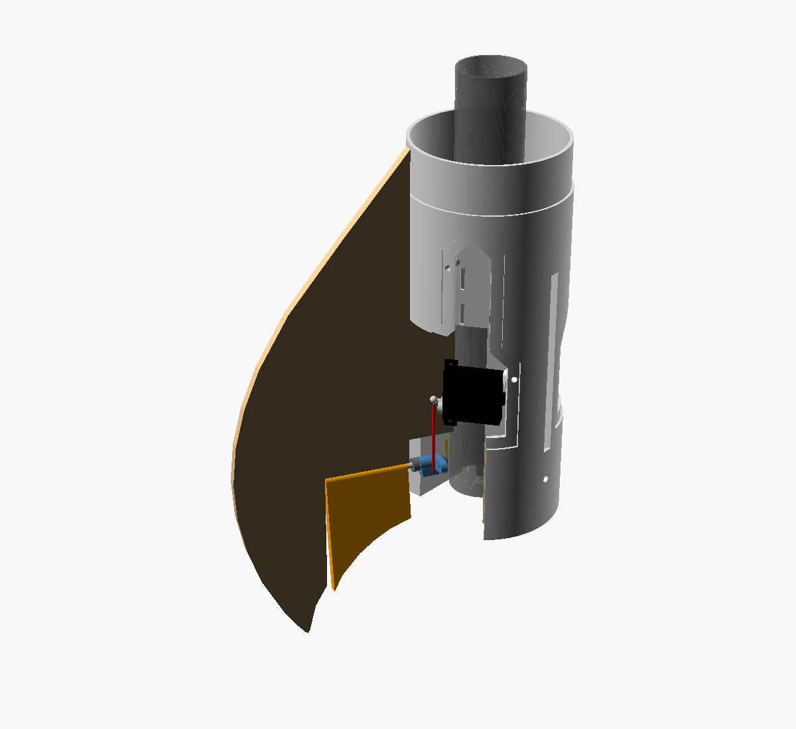

# Peregrine tail steering: ailerons on the fixed fins

This is a replacement aft section for the Apogee Peregrine with the camera nose
and CATS Vega. Each of the three fixed fins carries a trailing-edge aileron, and
the three ailerons together give roll control. The unbuilt Apogee Zephyr can take
the same can from new; its fin set is a parameter (`Fin_Set = "Zephyr"`).

Status: CAD-verified design. Nothing is printed or bench-tested yet. The checks
below are hand estimates and CAD checks, not test results.




## Why

The CFD study (MyLevel1Peregrine `cfd/REPORT.md`) found that the tail fins
straighten the canard swirl and return 1.2–1.4 times the canard roll moment. With
fixed fins, canard roll control therefore works backwards: Cl_δ = −0.0030 /deg net,
against +0.0087 /deg for the canards alone. Surfaces at the tail have nothing
downstream of them, so they do not reverse.

These are ailerons on fixed fins, not all-moving fins. If a servo fails or a
surface jams, the fixed fin still gives passive stability.

## Layout

Frame: Z = 0 at the base (the aft end of the body), +Z forward. Fins are at
0/120/240° and the rail buttons at 60°, as in `PeregrineL2.ork`. Stations in mm
from the nose tip are x = 1651.68 − Z.

| Item | Where |
|---|---|
| Printed PC can (`FinCan.stl`) | Z 0–220 at the full 101.5 OD (x 1431.7–1651.7). A 30 mm shoulder (OD 98.4) carries the paper tube |
| Paper aft tube | The forward 237.2 mm of the flown aft tube (x 1194.5–1431.7), so the overall length stays 1651.68 |
| Fixed fins | 1/4 in (6.35 mm) Baltic birch plywood, the kit material of both rockets. Through-the-wall tab Z 55–175, glued to the motor tube. The root LE stays at x 1402.76 (Z 248.9), so the CFD and OpenRocket CP still apply |
| Ailerons (`Aileron_*.stl`) | Solid PC. Hinge line radial at Z 34. They span 0.8–55 mm off the body; chord 34–74 mm (Peregrine). 2623 mm² each, 11 % of the fin |
| Hinge | Ø4 mm silver-steel shaft with a D-flat, radial. It runs in two NSK 684AZZ bearings in the can (centres at r 27.0 and 45.75), then 52 mm into the aileron's printed D-bore |
| Crank | Printed PC, on the shaft between the bearings. Arm 12 mm toward the servo; M3 set screw on the flat |
| Pushrod | M2 rod, 52 mm between ball centres, M2 ball links at both ends. It runs parallel to the axis at r 39.8, 17.5° from its fin (crank ball 38.0 mm out along the shaft, 12 mm off the fin plane) |
| Servo | MKS HV6160 lying flat in the annulus (case r 33–43.5), centred 57.5° from its fin, output pointing at the fin. Horn ball at 8 mm. Link ratio 1.5:1 (aileron torque / servo torque) |
| Hatches | One per servo, flush in a 1.6 mm rebate, held by M3 screws in ruthex inserts. The sector-A hatch also covers the LiPo |
| Motor | 38 mm motor tube (kit, 279.4 mm), aft end 12.7 mm above the base, glued as in a normal build. The motor retainer goes on the tube end, as now |
| Thrust path | Motor thrust ring → motor tube → fin tabs and hinge pillars (epoxy) → can → shoulder → paper tube. The bearings carry only aileron loads |
| Forward seal | Kit plywood centering ring with the eyebolt, solid, at Z 251 (x 1400.7). It is the drogue gas seal; the wire pass through it is potted |
| Rail buttons | Unchanged. The aft button is on the can (60°, Z 53.98 = x 1597.7) in an RX-M4x8.1 insert boss. The forward button stays on the paper tube (x 1299.3) |

**Sectors.**
- Sector A (0–120°): servo 0 plus the LiPo (Tattu 450 mAh 2S 75C long pack, 61 × 16 × 15 mm). The fuse, capacitor and harness are under the same T-shaped hatch.
  - This hatch lies under the 60° rail line. With three identical units 120° apart, one hatch always does.
  - The cover is flush, and its three screw heads sit off the rail strip (60 ± 18°).
- Sector B: servo 1 and the power switch (Schurter 0033.4513 at 180°, Z 178).
- Sector C: servo 2.
- The fin ribs stop at Z 177.5, so the leads cross between sectors above that.

**Roll sense (CAD frame).**
- Aileron δ > 0 is `rotate([δ,0,0])` in the fin's frame: the trailing edge moves toward a larger angle, counter-clockwise seen from the nose.
- All three ailerons at δ > 0 give a roll moment along −Z, clockwise seen from the nose.
- The three units are identical copies at 120°, so one signal gives pure roll and no reverser is needed.
- Check the servo pulse sign on the bench.

## Parts to print

All parts are PC (`L2-PrintSettings.md`). Every part prints without supports. The verifier checks that no downward-facing patch is wider than 7 mm. The widest is 5.6 mm: the slot ceilings and the bridge over the crank window.

| File | Qty | Orientation and settings | Mass (solid PC) |
|---|---:|---|---:|
| `BearingCoupon.stl` | 1 | Print first. One hinge block: check the bearing seats, the shaft through the wall and the crank | 10 g |
| `FinCan.stl` | 1 | Aft end down. 250.0 mm tall (P1S). 6 walls, 70 % gyroid, 0.12 mm, brim 5 mm, enclosed. Its walls are 1.6–2.4 mm, so it is nearly all perimeters | 347 g |
| `HatchServo.stl` | 2 | Standing, as it sits on the rocket. Solid | 10 g |
| `HatchServoLipo.stl` | 1 | Standing. Solid | 14 g |
| `Crank.stl` | 3 | Hub up, inboard collar on the bed. Solid | 2 g |
| `Aileron_Peregrine.stl` | 3 | Standing on the root, D-bore vertical. Solid (8 walls, as the PC fins), brim 3 mm | 20 g |
| `Aileron_Zephyr.stl` | 3 | Zephyr only. Same settings. Clipped 5 mm ahead of the fixed fin tip | 14 g |

Cut from 1/4 in plywood:
- `FixedFin_Peregrine.dxf`: 3 off. The aileron cut-out and the through-the-wall tab are included.
- `FixedFin_Zephyr.dxf`: 3 off, Zephyr only.

## Checks

These are numbers from `tools/tailsteer_estimate.py`, which reads the SCAD echo and the STLs.
- **Load case:** q = 10.79 kPa, M 0.39. This is the J350 peak of 132.7 m/s from the .ork and the top CFD case.
- **Fin lift slope:** the CFD fin-set CN_α, 10.35 /rad, which is 6.90 /rad per fin at the body reference area.

### Roll authority (estimate)

- **Method:** strip theory over the aileron span. Thin-airfoil flap effectiveness τ(c_f/c) × 0.85 for gaps and viscosity, scaled to the CFD fin lift slope (0.38 × 2π on the fin's own area).
- **Result:** Cl_δ = **+0.073 /deg** for the Peregrine and +0.069 /deg for the Zephyr (clipped ailerons, see Landing).
- **Against the canards:**
  - 24× the magnitude of the canards' net −0.0030 /deg, and with the correct sign;
  - 8.3× the canards alone (+0.0087 /deg).
- **Roll moment at 1°:** 0.27 N·m at M 0.25 and 0.64 N·m at M 0.39.
- **Steady roll rate at 1°:** 0.43 rev/s at 85 m/s and 0.67 rev/s at 133 m/s, from fin roll damping only.

This is a linear upper estimate. Real flap effectiveness on a low-aspect fin with gaps can be lower; a CFD check of one deflection would settle it. The canard-tuned roll gains do not carry over: the sign flips and the magnitude is about 24× larger.

### Hinge moment and servo torque margin

The deflection part uses unreduced 2-D thin-airfoil hinge moments. The incidence part is scaled to the CFD 3-D slope (× 0.38). Real hinge moments are usually 0.5–0.7 of 2-D thin-airfoil values, so these are conservative.

Hinge-moment coefficients, on the local aileron chord, strip by strip (c_f/c 0.14–0.33 Peregrine, 0.08–0.19 Zephyr):

| Fin set | Ch_δ | Ch_α |
|---|---|---|
| Peregrine | −0.90 to −0.98 /rad | −0.41 to −0.67 /rad |
| Zephyr | −0.88 to −0.92 /rad | −0.31 to −0.49 /rad |

| Case | Hinge moment | Servo torque (÷ 1.5) | HV6160 stall at 6.0 / 7.4 / 8.4 V | Margin |
|---|---:|---:|---|---:|
| 10° aileron, α 4° | 0.257 N·m | 0.172 N·m | 1.42 / 1.67 / 1.82 N·m | 8.3× / 9.7× / 10.6× |
| 15° (mechanical limit), α 6° (4° × 1.5) | 0.386 N·m | 0.257 N·m | as above | 5.5× / 6.5× / 7.1× |

- **Stall torque source:** 14.5 / 17.0 kg·cm at 6.0 / 7.4 V (servodatabase, as for the canards) and 18.6 kg·cm at 8.4 V (retailer).
- **Rate:** about 300 °/s at the aileron, unloaded.
- **Travel:** the servo turns ±22.9° for ±15° of aileron. The gain near neutral is 1.50.

### Bearings and shaft

**Bearing:** NSK 684AZZ, d 4, D 9, B 4 mm, ZZ shields, Cr 705 N, C0r 225 N, 1.01 g (nsk.com, 684AZZ1MC3P6). Why this part:
- Shields, not contact seals, so there is no seal drag in the servo's load.
- The shaft must be 4 mm to stay inside a 6.35 mm aileron (1.2 mm walls), so the bore is 4 mm. The 9 mm OD keeps the housing at 13.1 mm, which leaves room for the crank window and the bay walls; no larger size was tried.
- ~/mdoc has no bearing datasheets.

**Flight case (15°, α 6°):**
- The aileron load is 22.0 N at r 82.6. Add the pushrod force of 32.2 N, acting 38.0 mm out along the shaft.
- **Outer bearing:** 68 N, static factor C0r/P = **3.3**.
- **Inner bearing:** 45 N, factor 5.0. The aileron is cantilevered, so the outer bearing carries the couple F·(a+L)/L.
- Under ±15° oscillation, life is not a limit: Cr/P = 10.

**Shaft:** silver steel 1.2210, annealed. The yield of 450 MPa is an assumed typical value, not a datasheet figure.
- **Flight:** bending at the outer bearing is 0.81 N·m, or 147 MPa with the D-flat. Factor 3.1.
- **Landing and handling:** the shaft yields at about 68 N on the aileron's centre of pressure. The bearings then carry 200 / 133 N, close to C0r on the outer one. The shaft is the fuse.
- That holds only for annealed silver steel. Do **not** substitute a hardened linear shaft or a hardened D-cut shaft: with one, the outer bearing passes C0r before the shaft yields.
- A hard side landing on an aileron can bend the shaft. To replace it: undo the set screw from the open aft end, pull the shaft out through the wall, fit a new 79 mm rod. Check the bearings at the same time.
- **Tail first, the fixed fin must touch the ground before any aileron.** The model clips each aileron `Skid_Margin` = 5 mm ahead of the aft-most point of the notched fixed fin. The verifier checks this for both fin sets at 0° and ±15°.
  - **Peregrine:** the notched fixed fin reaches 76.1 mm aft of the base and the aileron 40.5 mm, so the clip does not bite.
  - **Zephyr:** on the kit outline the aileron's aft corner (y_f 12.5) would reach 24.4 mm aft of the base. The notched fixed fin reaches only 4.7 mm. The clip trims the Zephyr aileron at the fixed fin's tip minus 5 mm, so it now ends 0.3 mm *ahead* of the base.
  - The Zephyr aileron is 1739 mm² (it was 2378) and Cl_δ is +0.069 /deg.
  - Against the kit outline, the Zephyr fin loses 643 mm² (3.3 %) of area around Z −8. That moves its CP slightly forward: check the Zephyr margin in OpenRocket with `FixedFin_Zephyr.dxf` + `Aileron_Zephyr.stl` before flying.

### Printed-part stress (PC; about 45 MPa in-layer and 20 MPa across layers, estimates)

| Spot | Load | Stress |
|---|---|---:|
| Bearing seats, bearing pressure | Flight 68 / 45 N | 1.9 / 1.3 MPa |
| Bearing seats at shaft yield | 200 / 133 N | 5.6 / 3.7 MPa |
| Inner housing into its web (69 mm²) and the motor-tube glue | 45 N | 0.7 MPa |
| Crank arm root, 4 × 8 mm, in-layer | Flight pushrod 32 N | 6 MPa |
| Crank arm root | HV6160 stall at 8.4 V: 228 N | 40 MPa. This is the limit case, a jammed aileron at full servo torque |
| Servo lug pedestals | Stall reaction 1.82 N·m over 39 mm = 47 N per M2.5 bolt | 2.9 MPa bearing |
| Aileron D-bore | 0.39 N·m on the flat over 52 mm | ~1.5 MPa |
| Aileron plate, chordwise at the bore | 8.4 kPa mean | 3.4 MPa |

**Walls (verifier):**
- Outer wall ≥ 2.25 mm everywhere it is plain (2.4 nominal).
- Bearing housings: checked ≥ 1.95 mm round the seats, 2.0 mm measured. They are teardrop-topped for printing.
- Insert bosses keep ruthex W all round: RX-M3x5.7 1.6 mm, RX-M4x8.1 2.1 mm.

### Heat (servos and LiPo against the motor)

**Gaps (verifier):**
- Servo case to motor tube 12.7 mm.
- LiPo 10.5 mm.
- Switch body 6.5 mm.
- A 1.6 mm PC floor plate stands between each servo or LiPo and the motor tube, so neither sees the tube directly.

**Assumptions:**
- The motor-tube surface rises to 100 °C at 30 s and stays there for 10 min. This is conservative and not measured.
- ε 0.9 on both sides of the floor plate, still-air conduction, 30 °C start.

**Budget:**
- The LiPo's discharge limit binds. 60 °C is a typical LiPo figure, not a Tattu datasheet value; it leaves 30 °C of headroom on a 30 °C day.
- I found no published operating temperature for the HV6160; the same 60 °C is assumed for it.

**Result:**

| Time | Servo | LiPo |
|---|---:|---:|
| Apogee, about 12 s | +0.0 °C | +0.0 °C |
| Landing | +0.2 °C | +0.1 °C |
| After 10 min on the ground | +9.0 °C | +7.1 °C |

Optional: aluminium tape on the motor tube in the servo and LiPo sectors (ε about 0.05) cuts the radiated part about tenfold.

### Mass, CG and stability

New aft section, with Z above the base. Plywood is 0.725 g/cm³ (.ork) and PC 1.20 g/cm³, solid. Fin and aileron centroids come from their outlines; the can, hatch covers and cranks from their meshes in the assembled pose.

| Item | Mass | Z |
|---|---:|---:|
| FinCan | 346.6 g | 106.9 |
| Hatch covers ×3 | 35.0 g | 112.2 |
| Cranks ×3 | 5.0 g | 32.7 |
| Ailerons ×3 | 60.6 g | 10.2 |
| Fixed fins ×3 (notched, with tab) | 328.3 g | 90.7 |
| Shafts ×3, bearings ×6 | 29.5 g | 34 |
| Servos ×3 | 92.1 g | 96.5 |
| Links, studs, rods ×3 (est.) | 12.0 g | 60 |
| LiPo | 28.0 g | 158.5 |
| Switch, fuse, capacitor, harness (est.) | 22.0 g | 175 |
| Inserts, screws, nuts (est.) | 14.0 g | 110 |
| Paper tube 237.2 mm | 106.5 g | 338.6 |
| Motor tube, plywood CR + eyebolt, rail buttons (kit) | 113.3 g | — |
| **Total** | **1192.8 g** | **126.6** |

**Against the current section:**
- The current fixed-fin section, from its .ork components, is 718.9 g at Z 132.2. Epoxy and paint are left out on both sides.
- **Change:** +474 g, with the section's own centroid 5.6 mm further aft.
- The signal pair through the rocket adds about 10 g, spread along its length.

**Stability:** OpenRocket J350 simulation, CP 1.219 m.

| State | Mass | CG | Margin |
|---|---|---|---|
| Liftoff | 4.491 → 4.965 kg | 0.968 → 1.022 m | 2.47 → **1.94 cal** |
| Max speed / burnout | 4.122 → 4.596 kg | 0.922 → 0.985 m | 2.92 → **2.30 cal** |

- The aileron gaps leave the fin outline unchanged, so the CP does not move.
- The CFD CP is 4 cm further aft (1.262 m), which gives 2.7 cal at max speed.
- **Conclusion:** the CG move matters for apogee (+10 % mass), not for stability. The margin stays near 2 cal or more.

## Wiring and separation joints

Signal and ground run from the Vega's servo header in the nose to the tail. Servo power comes from the tail pack, so there is no voltage drop over the long run. The three servos share one signal through a Y at the tail. The pack negative ties to the signal ground there.

Joints, from the .ork:
- Nose 94.05 + 6 + 368.23 + 15 = 483.28.
- Forward tube 457.2.
- Switch band 25.4, with the e-bay coupler running 88.9 into each neighbour.
- 9-inch tube 228.6.
- Aft tube 457.2.

| Station (mm from tip) | Joint | Opens | Crossing |
|---|---|---|---|
| 483.3 | Nose shoulder / forward tube | At main: pyro 2, the charge on the nose bulkhead | Potted pass through the nose bulkhead, then pull-apart connector 1 just aft of it, with a lanyard to the main shock cord |
| 940.5 | Forward tube / e-bay switch band | Never (screwed) | Potted pass through the forward e-bay bulkhead |
| 965.9 | E-bay / 9-inch tube | At apogee: pyro 1, drogue | Potted pass through the aft e-bay bulkhead, then pull-apart connector 2 just aft of it, with a lanyard |
| 1194.5 | 9-inch / aft tube (coupler 1092.9–1296.1) | Assumed glued; the booster is one piece | None. Tape the pair to the tube wall in the drogue bay |
| 1400.7 | Plywood CR (gas seal) | — | Potted pass into the can annulus |
| 1431.7 | Paper tube / can shoulder | Never (glued) | — |

The camera-nose architecture puts the main joint at the nose (483.3) and the drogue
joint at the aft end of the passive e-bay (965.9). If the 9-inch / aft-tube joint is
flown separable, add a third connector there.

**Connectors.** JST RCY (SYP) 2-pin pairs. They have no latch, so they pull apart under a few newtons. Tie each half to its own section with 1 mm Kevlar, leaving 30–50 mm of slack, so the lanyard takes the pull and the wire does not.

**Cable.** About 1.3 m of 26 AWG silicone twisted pair, routed with the drogue lead along the main shock cord.

**Power.**
- Tattu 2S → 7.5 A fuse → Schurter switch → 1000 µF 16 V low-ESR capacitor → Y harness to the three HV6160s.
- The pack runs 6.6–8.4 V, inside the HV6160's 4.8–8.4 V.
- A sustained triple stall opens the fuse. The ailerons then trail to neutral, because the hinge moments are restoring.

**Firmware.**
- Centre the ailerons at apogee, before pyro 1 fires. After connector 2 parts, the servos see no pulses.
- Bench-verify whether the HV6160 holds or goes limp without pulses. Either is acceptable once the ailerons are centred.
- Bench-verify that it accepts the Vega's 3.3 V signal (the same open item as for the canards).
- Limit commands to ±10°. ±15° is the CAD-checked mechanical travel.

## Build order (retrofit of the flown Peregrine)

1. Print `BearingCoupon.stl`. Check the following, and adjust `Brg_Seat_D` or `Wall_Hole_D` before the big print if needed:
   - the bearings press or glue into the Ø9.1 teardrop seats;
   - the shaft passes the Ø5 wall hole;
   - the crank turns freely between the bearings.
2. Print the can, hatches, cranks and ailerons. Install the ruthex inserts:
   - 7 × RX-M3x5.7 in the hatch bosses;
   - 1 × RX-M4x8.1 in the rail boss;
   - 3 × RX-M3x4.0 SHORT in the crank bosses.
3. **Cut the flown aft tube** 237.2 mm from its forward end (220 mm above the base). Keep the forward piece, still joined to the 9-inch tube by the glued coupler. It carries the forward rail button.
   - The cut goes through the three **old fin roots** as well. Their root LE is at Z 248.9, and above the kit slot (which ends at about Z 157) they are only surface-filleted to the tube.
   - Saw through each fin at the cut line, close to the tube.
   - Cut only the paper tube around the rest of the circumference. The old motor tube runs free inside there, because the kit rings sit at Z 25 and Z 156, so the aft piece then slides out.
   - On the kept piece, saw the 29 mm fin stubs off flush. Sand the stubs and their fillets down to clean paper over Z 220–250 at 0/120/240°: the new fin roots land there.
   - The aft piece, with the old fins, motor tube, rings and retainer, is scrap.
4. Cut three fins from 1/4 in Baltic birch to `FixedFin_Peregrine.dxf`. Seal the edges with thin CA.
5. **Shafts:** cut three Ø4 h9 silver-steel rods to 79.0 mm. File a 0.5 mm flat along the full length and deburr.
6. **Hinges.** The aft end of the annulus is open.
   - Pass both bearings up through the crank window and push them into their seats with Loctite 641.
   - Put the crank in the window, arm toward the servo.
   - Push the shaft in from outside through the outer bearing, the crank and the inner bearing, flat facing aft.
   - Tighten the M3 × 5 cup-point set screw from the aft end.
   - It must turn freely through ±15°.
7. **Motor tube.**
   - Optionally, tape the servo and LiPo sectors with aluminium tape.
   - Epoxy the tube into the can bore (0.2 mm gap), aft end 12.7 mm above the base. It glues to the hinge pillars and the rib flanks.
8. **Fins.**
   - Push the tabs through the slots onto the motor tube and epoxy them, with tab-to-tube and slot fillets.
   - Square them with a fin guide.
   - The fin's cut-out edge must be parallel to the hinge line.
9. **Ailerons.**
   - Epoxy each aileron onto its shaft stub with a 0.8 mm shim at the root.
   - Clamp it flush with its fin, with a straightedge across both, while the epoxy cures.
   - Check ±15° free with the 0.8 mm gaps.
10. **Forward end.**
    - Epoxy the plywood CR with the eyebolt onto the motor tube at Z 251–257.4. It must be solid, apart from the potted wire pass.
    - Slide the kept tube piece over the shoulder and the CR and glue it.
    - Fillet the fins' forward roots, Z 220–249, onto the paper.
11. **Servos.**
    - Centre each servo at 1520 µs.
    - Fit the metal arm pointing inward. Drill it for the M2 ball stud at 8 mm from the spline.
    - Glue the M2.5 nuts into the lug traps.
    - Fit the servo and drive the M2.5 × 10 lug bolts from outside.
    - Set each pushrod to 52 mm between ball centres, so the aileron sits at neutral.
12. **Wiring.**
    - Harness, fuse and capacitor go in sector A. Fit the switch in sector B: drill the Ø6 pilot to Ø12.7 and file the R1.2 key upward, as on the nose.
    - Fit the LiPo on its floor with a 10 mm Velcro strap through the slots and a foam pad under the hatch.
13. **Rail button and motor retainer:** as now.

**Zephyr** (from new):
- Use the same can and hatches with `Aileron_Zephyr.stl` and `FixedFin_Zephyr.dxf`.
- Cut the kit's aft tube 220 mm short.
- The kit motor tube must reach Z 258 (≥ 246 mm long from its aft end at Z 12.7) to carry the plywood CR.

## Hardware

| Item | Qty | Use |
|---|---:|---|
| NSK 684AZZ (4 × 9 × 4, ZZ) | 6 | Hinge bearings |
| Ø4 h9 silver steel (1.2210), 79 mm | 3 | Hinge shafts; 0.5 mm D-flat filed full length |
| MKS HV6160 + its metal single arm | 3 | Aileron servos |
| M2 ball links (Ø4.8 ball) + M2 ball studs + nuts | 6 | Pushrod ends, on the horn (8 mm) and crank (12 mm) |
| M2 stainless threaded rod, about 42 mm, + 2 lock nuts each | 3 | Pushrods, 52 mm between ball centres |
| ruthex RX-M3x4.0 SHORT + M3 × 5 cup-point set screw (ISO 4029) | 3 each | Crank to shaft flat |
| M2.5 × 10 screws + M2.5 hex nuts | 6 each | Servo lugs; nuts glued in the traps |
| ruthex RX-M3x5.7 + M3 × 6 button head (ISO 7380) | 7 each | Hatches: 3 on sector A, 2 each on B and C |
| ruthex RX-M4x8.1 + M4 × 16 (or #8-32) | 1 each | Aft rail button (kit 1010 button) |
| Tattu 450 mAh 2S 75C long pack (61 × 16 × 15 mm, 28 g) | 1 | Servo power |
| Schurter 0033.4513 + 0098.0043 nut | 1 | Servo power switch |
| 7.5 A mini blade fuse + holder, 1000 µF 16 V low-ESR capacitor, 3-way Y harness | 1 each | Power |
| JST RCY (SYP) 2-pin pair + 1 mm Kevlar | 2 | Pull-apart at 483.3 and 965.9 |
| 26 AWG twisted pair, silicone | ~1.3 m | Vega signal + ground to the tail |
| Apogee 38 mm motor tube, 279.4 mm | 1 | Motor mount |
| Kit plywood centering ring 38/98 + 1/4 in eyebolt, nut, washers | 1 | Gas seal and drogue cord anchor |
| 1/4 in (6.35 mm) Baltic birch plywood | ~330 × 350 mm | 3 fixed fins |
| Structural epoxy (thickened), Loctite 641, thin CA, aluminium tape, 10 mm Velcro, foam | — | Assembly |

## Concerns and open items

- **Mass.** +474 g at the tail. The margin stays near 2 cal, but apogee drops. The can is mostly 2.4 mm PC wall (about 165 g); a thinner wall would break `L2-PrintSettings.md`.
- **Landing.** The 4 mm shaft is the weakest link if an aileron is hit, and it yields at about 70 N. Carry spare shafts and bearings.
- **Free play.** Ball links plus servo gear lash make up the aileron free play. Control-surface flutter is not analysed. Check that free play is under 0.5° at the trailing edge.
- **Authority estimate.** It is about 8× the canards' own. Linear strip theory overestimates partial-span flaps on low-aspect fins. One CFD case at δ = 5° would give the real number.
- **Bench items.**
  - HV6160 spline and arm fit.
  - 3.3 V signal.
  - Behaviour without pulses.
  - Servo sign.
  - Bearing seat fit (coupon).
- **Forward pedestal ledge.** It overhangs 4.3 mm over the servo case; the slicer bridges it. It holds only the lug nut, and the lug seats on its vertical face.

## Reuse of the house libraries

Nothing is included.
- `BearingLib.scad` makes printed ball races, not seats for stock bearings.
- `FinCan2Lib.scad` builds printed-fin cans with posts and an integral coupler; this can needs through-the-wall plywood fins and internal servo bays.
- `TubesLib.scad` and `CommonStuffSAEmm.scad` give tube constants and inch bolt sizes. This design uses the measured kit tube (101.5 / 99.0) from `PeregrineFinCan.scad` and metric ruthex inserts.

With no includes, the renders print no library echoes and no warnings.

## Verification

Python: `pip install -r tools/requirements-tailsteer.txt` (numpy, trimesh, manifold3d, networkx, rtree, scipy).

```
~/.cache/camnose-venv/bin/python -I tools/verify_tailsteer.py --export   # renders, 62 checks; writes STLs/DXFs here only if all pass
~/.cache/camnose-venv/bin/python -I tools/tailsteer_estimate.py          # the numbers above
~/.cache/camnose-venv/bin/python -I tools/tailsteer_estimate.py --fin-set Zephyr
```

`verification.json` holds the last run: 62/62 passed.

**What the verifier checks:**
- Every part is one closed solid; the can is ≤ 250.5 mm tall.
- Everything is supportless.
- The can clears the motor tube, retainer, servos, horns, shafts, cranks, ailerons, fins, LiPo, switch, hatch covers and paper tube.
- Both bearing seats are supported.
- The motor-tube epoxy gap is 0.2 mm.
- The air gaps to the motor tube hold.
- Wall thickness and insert walls hold.
- The rail-button insert sits on the 60° line at the .ork station, and no screw head lies on the rail strip.
- The servo with its horn on lifts straight out through its hatch without touching the can. This is checked for sector A (T-shaped hatch) and sector B (gable hatch); sector C is identical to B. The LiPo lifts out of sector A the same way.
- At every 5° step through ±15°, with the linkage solved:
  - nothing collides: aileron, crank, pushrod or horn;
  - aileron to can and aileron to fixed fin: checked ≥ 0.78 mm, 0.8 measured (0.8 by design);
  - pushrod and ball links to can: checked ≥ 1.2 mm, 1.21 measured.
- The ailerons stay 18 mm off the rail.
- The Zephyr ailerons are free through the travel.
- For both fin sets the fixed fin reaches ≥ 3 mm further aft than every aileron point at 0 and ±15°: Peregrine 35.5 mm, Zephyr 5.0 mm.

All of this is CAD, not printed fit, strength or flight behaviour.
