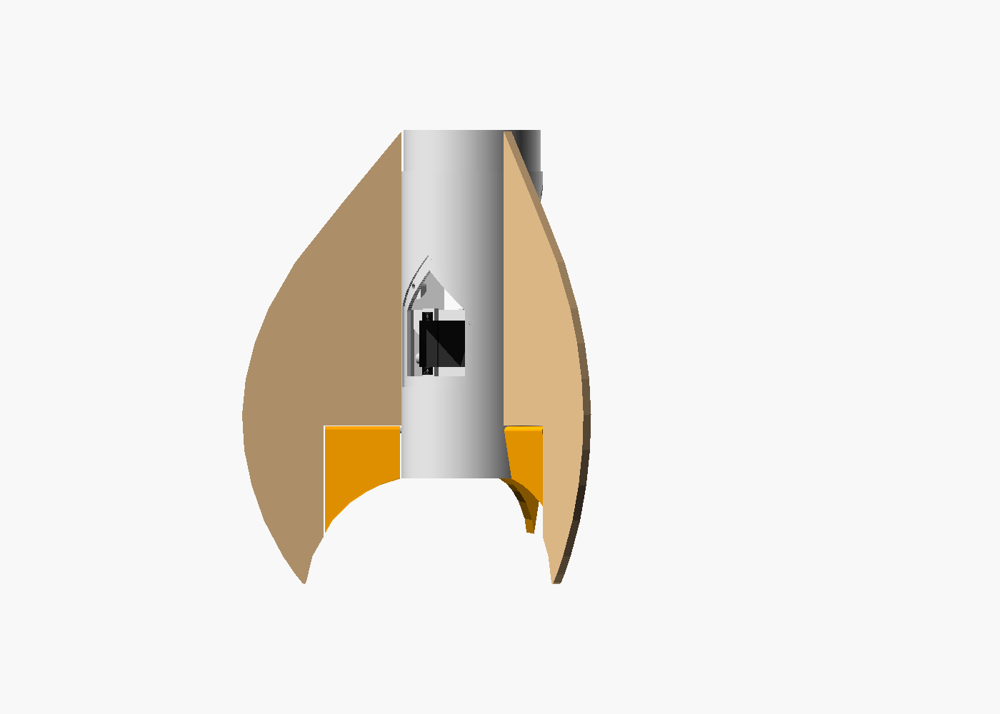

# Peregrine tail steering: ailerons on the fixed fins

This is a replacement aft section for the Apogee Peregrine with the camera nose
and CATS Vega. Each of the three fixed fins carries a trailing-edge aileron, and
the three ailerons together give roll control. The Apogee Zephyr has its own Mach 0.8
build from the same SCAD (`Airframe = "Zephyr"`): see `../ZephyrTailSteer/README.md`.

Status: CAD-verified design. Nothing is printed or bench-tested yet. The checks
below are hand estimates and CAD checks, not test results.




## Why

The CFD study (MyLevel1Peregrine `cfd/REPORT.md`) found that the tail fins
straighten the canard swirl and return 1.2–1.4 times the canard roll moment. With
fixed fins, canard roll control therefore works backwards: Cl_δ = −0.0030 /deg net,
against +0.0087 /deg for the canards alone. Surfaces at the tail have nothing
downstream of them, so they do not reverse.

These are ailerons on fixed fins, not all-moving fins. If a servo fails or a
surface jams, the fixed fin still gives passive stability.

## Layout

Frame: Z = 0 at the base (the aft end of the body), +Z forward. Fins are at
0/120/240° and the rail buttons at 60°, as in `PeregrineL2.ork`. Stations in mm
from the nose tip are x = 1651.68 − Z.

| Item | Where |
|---|---|
| Printed PC can (`FinCan.stl`) | Z 0–220 at the full 101.5 OD (x 1431.7–1651.7). A 30 mm shoulder (OD 98.4) carries the paper tube |
| Paper aft tube | The forward 237.2 mm of the flown aft tube (x 1194.5–1431.7), so the overall length stays 1651.68 |
| Fixed fins | 1/4 in (6.35 mm) Baltic birch plywood, the kit material of both rockets. Through-the-wall tab Z 55–175, glued to the motor tube. The root LE stays at x 1402.76 (Z 248.9), so the CFD and OpenRocket CP still apply |
| Ailerons (`Aileron*Half_*.stl`) | Solid PC, two halves split on the fin's mid-plane and clamped round the shaft by 4 × M2 × 5 countersunk screws (from the −Y face into tapped holes in the +Y half; 5.8 mm from the head seat to the tap bottom, 0.6 mm of +Y skin left). The D-groove is line-to-line with the shaft and runs 1.5 mm past the shaft end. Only round the shaft (from the leading edge to 6.5 mm aft of the hinge, and out to 1.5 mm past the shaft end) the split faces stand 0.25 mm apart; elsewhere they touch. The two inner screws sit 4.5 mm aft of the axis over the shaft, which takes their load; the two outer ones sit on face-to-face contact (play 0 in CAD). A Ø2 × 14 hardened dowel through a cross hole in the shaft, lying along the chord in the split plane, carries the torque. Hinge line radial at Z 34. They span 0.8–55 mm off the body; chord 34–74 mm (Peregrine). 2623 mm² each, 11 % of the fin |
| Hinge | Ø4 × 54 mm silver-steel shaft with a D-flat, radial, its inner end 0.3 mm inside the inner bearing (0.9 mm clear of the housing floor). It runs in two NSK 684AZZ bearings in the can (centres at r 27.0 and 45.75), then 28 mm into the aileron's D-groove. The dowel's cross hole is 44.45 mm from the shaft's inner end. 54 mm is the longest shaft that can be pulled out into the aileron cut-out (see Field service) |
| Crank | Printed PC, on the shaft between the bearings, M3 set screw on the flat. Clevis arm 14 mm toward the servo: the ball link's 4.8 mm pivot ball sits between two 2.5 mm cheeks on a Ø2 hardened dowel, centred on the pushrod line, so the arm sees no torsion and the pin is in double shear |
| Pushrod | M2 rod, 52 mm between ball centres, M2 ball links at both ends. It runs parallel to the axis at r 37.7, 21.8° from its fin (crank ball 35.1 mm out along the shaft, 14 mm off the fin plane). At the horn the pivot ball sits 3.95 mm off the arm's mid-plane on an M2 × 10 12.9 screw through the servo's metal arm: nut on the case side, arm, 0.3 mm shim, ball, head |
| Servo | MKS HV6160 lying flat in the annulus (case r 33–43.5), centred 60.4° from its fin, output pointing at the fin. Horn ball at 9 mm (its nut clears the servo case at full travel). Link ratio 1.56:1 (aileron torque / servo torque) |
| Hatches | One per servo, flush in a 1.6 mm rebate, held by M3 screws in ruthex inserts. The sector-A hatch also covers the LiPo. On the fin side the rebate is only 3 mm wide, so the nearest recess is 13.8 mm from the fin face (the verifier's measurement), clear of a 10 mm fin-root fillet + 2 mm |
| Motor | 38 mm motor tube (kit, 279.4 mm), aft end 12.7 mm above the base, glued as in a normal build. A new AeroPack RA38L retainer (OD 50.0, 12.7 long, ≥ 9.5 mm of tube exposed) goes on the tube end; the can keeps a Ø52 keep-out from the base to Z 26.4 |
| Thrust path | Motor thrust ring → motor tube → fin tabs and hinge pillars (epoxy) → can → shoulder → paper tube. The bearings carry only aileron loads |
| Forward seal | Kit plywood centering ring with the eyebolt, solid, at Z 251 (x 1400.7). It is the drogue gas seal; the wire pass through it is potted |
| Rail buttons | Unchanged. The aft button is on the can (60°, Z 53.98 = x 1597.7) in an RX-M4x8.1 insert boss. The forward button stays on the paper tube (x 1299.3) |

**Sectors.**
- Sector A (0–120°): servo 0 plus the LiPo (Tattu 450 mAh 2S 75C long pack, 61 × 16 × 15 mm). The fuse, capacitor and harness are under the same T-shaped hatch.
  - This hatch lies under the 60° rail line. With three identical units 120° apart, one hatch always does.
  - The cover is flush, and its three screw heads sit off the rail strip (60 ± 18°). The LiPo part's screw sits on its far edge, where the rebate is 9.5 mm wide.
- Sector B: servo 1 and the power switch (Schurter 0033.4513 at 180°, Z 178).
- Sector C: servo 2.
- The fin ribs stop at Z 177.5, so the leads cross between sectors above that.

**Roll sense (CAD frame).**
- Aileron δ > 0 is `rotate([δ,0,0])` in the fin's frame: the trailing edge moves toward a larger angle, counter-clockwise seen from the nose. The flow is turned that way, so each fin is pushed the other way: the roll moment points along −Z, clockwise seen from the nose.
- The three units are identical copies at 120°, so one signal gives pure roll and no reverser is needed.
- The estimate tool prints magnitudes only. Check the servo pulse sign on the bench.

## Parts to print

All parts are PC (`L2-PrintSettings.md`). Every part prints without supports. The verifier checks that no downward-facing patch more than 0.1 mm (under one layer) above the bed is wider than 7 mm, measured as twice its largest inscribed circle. The widest is 6.8 mm: the 6.85 mm slot ceilings, which print as bridges.

| File | Qty | Orientation and settings | Mass (solid PC) |
|---|---:|---|---:|
| `BearingCoupon.stl` | 1 | Print first. One hinge block: check the bearing seats, the shaft through the wall and the crank | 10 g |
| `ShaftDrillJig.stl` | 1 | As is (D-channel flat on the bottom, teardrop top). Lay the shaft flat-down in the channel with its inner end on the stop and drill Ø2 through the guide: the hole lands 44.45 mm from the inner end, through the axis and square to the flat | 9 g |
| `FinCan.stl` | 1 | Aft end down. 250.0 mm tall (P1S). 6 walls, 70 % gyroid, 0.12 mm, brim 5 mm, enclosed. Its walls are 1.6–2.4 mm, so it is nearly all perimeters | 340 g |
| `HatchServo.stl` | 2 | Standing, as it sits on the rocket. Solid | 10 g |
| `HatchServoLipo.stl` | 1 | Standing. Solid | 13 g |
| `Crank.stl` | 3 | Hub up: the inboard collar, the clevis arm and the set-screw boss all stand on the bed. Solid. Ream the Ø1.95 pivot hole to a press fit on the Ø2 × 10 dowel (the bore is 10.2 mm: both cheeks 2.5 at the pivot) | 3 g |
| `AileronScrewHalf_Peregrine.stl` + `AileronTappedHalf_Peregrine.stl` | 3 each | Flat, outer face down, groove up. Solid. Tap the four Ø1.6 holes in the tapped half M2 | 10 + 10 g |

Cut from 1/4 in plywood:
- `FixedFin_Peregrine.dxf`: 3 off. The aileron cut-out and the through-the-wall tab are included.

## Checks

These are numbers from `tools/tailsteer_estimate.py`, which reads the SCAD echo and the STLs.
- **Load case:** q = 10.79 kPa (132.7 m/s at sea-level density, M 0.39). See "Load case and envelope" below for how it was chosen.
- **Fin lift slope:** the CFD fin-set CN_α, 10.35 /rad, which is 6.90 /rad per fin at the body reference area.

### Roll authority (estimate)

- **Method:** strip theory over the aileron span. Thin-airfoil flap effectiveness τ(c_f/c) × 0.85 for gaps and viscosity, scaled to the CFD fin lift slope (0.38 × 2π on the fin's own area).
- **Result:** |Cl_δ| = **0.073 /deg**. The sense is in Layout, "Roll sense".
- **Against the canards (magnitudes):**
  - 24× the canards' net 0.0030 /deg (which is reversed);
  - 8.3× the canards alone (0.0087 /deg).
- **Roll moment at 1°:** 0.27 N·m at M 0.25 and 0.64 N·m at M 0.39.
- **Steady roll rate at 1°:** 0.43 rev/s at 85 m/s and 0.67 rev/s at 133 m/s, from fin roll damping only.

This is a linear upper estimate. Real flap effectiveness on a low-aspect fin with gaps can be lower; a CFD check of one deflection would settle it. The canard-tuned roll gains do not carry over: the magnitude is about 24× larger. Set the sign on the bench.

### Hinge moment and servo torque margin

The deflection part uses unreduced 2-D thin-airfoil hinge moments. The incidence part is scaled to the CFD 3-D slope (× 0.38). Real hinge moments are usually 0.5–0.7 of 2-D thin-airfoil values, so these are conservative.

Hinge-moment coefficients, on the local aileron chord, strip by strip (c_f/c 0.14–0.33):

| Fin set | Ch_δ | Ch_α |
|---|---|---|
| Peregrine | −0.90 to −0.98 /rad | −0.41 to −0.67 /rad |

| Case | Hinge moment | Servo torque (÷ 1.56) | HV6160 stall at 6.0 / 7.4 / 8.4 V | Margin |
|---|---:|---:|---|---:|
| 10° aileron, α 4° | 0.257 N·m | 0.165 N·m | 1.42 / 1.67 / 1.82 N·m | 8.6× / 10.1× / 11.0× |
| 15° (mechanical limit), α 6° (4° × 1.5) | 0.386 N·m | 0.248 N·m | as above | 5.7× / 6.7× / 7.4× |

- **Stall torque source:** 14.5 / 17.0 kg·cm at 6.0 / 7.4 V (servodatabase, as for the canards) and 18.6 kg·cm at 8.4 V (retailer).
- **Rate:** about 290 °/s at the aileron, unloaded.
- **Travel:** the servo turns ±23.8° for ±15° of aileron. The gain near neutral is 1.56.

### Load case and envelope

All simulations in `PeregrineL2-CamNose.ork` were rerun in OpenRocket 24.12 (`tools/ORSimMass.java`), as saved and with the tail-steering change added (+0.460 kg at 1.531 m from the tip, as a zero-length mass so its CG sits there).

| Motor | Max speed as saved | With the tail |
|---|---:|---:|
| J350W (21 Feb sim) | **132.7 m/s** | 119.7 m/s |
| J420R (7 Feb sim) | 130.0 m/s | 117.1 m/s |
| HP-J270W | 128.6 m/s | — |
| I327DM | 106.2 m/s | 95.2 m/s |
| H550ST and smaller | ≤ 70.6 m/s | — |

- **Design q:** 10.79 kPa, the J350 as saved (the lighter, faster case) at sea-level density. The heavier rocket peaks at 8.8 kPa.
- `L2-PrintSettings.md` quotes about 200 m/s for the J420R. That figure belongs to an earlier, lighter printed design; this rocket reaches 130.0 m/s on the J420R in the .ork (117.1 with the tail).
- **Envelope** (15° aileron, α 6°; all aero loads scale with q):

| Speed (q) | Servo margin at 6.0 V | Bearing C0r/P | Shaft factor | Horn screw factor |
|---|---:|---:|---:|---:|
| 120 m/s (8.8 kPa), J350 with the tail | 7.0× | 4.2 | 3.8 | 4.6 |
| 132.7 m/s (10.79 kPa), design | 5.7× | 3.4 | 3.1 | 3.8 |
| **164 m/s (16.5 kPa), limit** | 3.7× | 2.2 | 2.0 | 2.5 |
| 200 m/s (24.5 kPa) | 2.5× | 1.5 | 1.3 | 1.7 |

- **Limit:** the Peregrine hinge is cleared to q = 16.5 kPa, 164 m/s at ISA sea level (on a −5 °C day the same q comes at 158 m/s), with every factor ≥ 2 (the shaft sets it; the horn screw is 2.5 there). Do not fly a motor that simulates faster than that without re-sizing the shaft and bearings. With Prandtl–Glauert compressibility (×1.09 at M 0.39) the limit is 155 m/s; the fastest motor with the tail flies 119.7 m/s.

**Flutter (rough):**
- Aileron panel, NACA TN 4197 fin formula (printed PC, G 0.6 GPa assumed): about 1280 m/s.
- Fixed fin, same formula (birch ply, G 0.38 GPa, taper 0.3 assumed): about 475 m/s.
- Aileron hinge mode: I = 1.8·10⁻⁵ kg·m² about the hinge. With the linkage at 77 N·m/rad (the servo holding full torque within 3°, assumed), it sits near 328 Hz. The aileron is not mass-balanced, so linkage free play is what matters: keep it under 0.5° at the trailing edge. This is no flutter analysis.

### Bearings and shaft

**Bearing:** NSK 684AZZ, d 4, D 9, B 4 mm, ZZ shields, Cr 705 N, C0r 225 N, 1.01 g (nsk.com, 684AZZ1MC3P6). Why this part:
- Shields, not contact seals, so there is no seal drag in the servo's load.
- The shaft must be 4 mm to stay inside a 6.35 mm aileron (1.2 mm walls), so the bore is 4 mm. The 9 mm OD keeps the housing at 13.1 mm, which leaves room for the crank window and the bay walls; no larger size was tried.
- ~/mdoc has no bearing datasheets.

**Flight case (15°, α 6°):**
- The aileron load is 22.0 N at r 82.6. Add the pushrod force of 27.6 N, acting 35.1 mm out along the shaft.
- **Outer bearing:** 67 N, static factor C0r/P = **3.4**.
- **Inner bearing:** 46 N, factor 4.9. The aileron is cantilevered, so the outer bearing carries the couple F·(a+L)/L.
- Under ±15° oscillation, life is not a limit: Cr/P = 10.6.

**Shaft:** silver steel 1.2210, annealed. The yield of 450 MPa is an assumed typical value, not a datasheet figure.
- **Flight:** bending at the outer bearing is 0.81 N·m, or 147 MPa with the D-flat. Factor 3.1.
- **Landing and handling:** the shaft yields at about 68 N on the aileron's centre of pressure. The bearings then carry 200 / 133 N, close to C0r on the outer one. The shaft is the fuse.
- That holds only for annealed silver steel. Do **not** substitute a hardened linear shaft or a hardened D-cut shaft: with one, the outer bearing passes C0r before the shaft yields.
- A hard side landing on an aileron can bend the shaft. **Field service, fins glued in place:**
  1. Undo the four M2 clamp screws. The aileron halves come off sideways (±Y).
  2. Undo the crank set screw from the open aft end.
  3. Lift the drive dowel out of the shaft. Pull the shaft outward 25.9 mm, until its inner end clears the wall. The 54 mm shaft then lies wholly in the aileron cut-out, below the fixed fin's notch edge, and comes out sideways.
  4. Fit a new 54 mm rod the same way in reverse. Check the bearings at the same time.
  The fixed fin covers the hinge axis outboard of the cut-out (r > 106.6), which is why the shaft is 54 mm and the aileron is split. The verifier steps this whole path.
- **Tail first, the fixed fin must touch the ground before any aileron.** The model clips each aileron `Skid_Margin` = 5 mm ahead of the aft-most point of the notched fixed fin. The verifier checks this at 0° and ±15°: the notched fixed fin reaches 76.1 mm aft of the base and the aileron 40.5 mm, so the clip does not bite.

### Printed-part stress (PC; about 45 MPa in-layer and 20 MPa across layers, estimates)

| Spot | Load | Stress |
|---|---|---:|
| Bearing seats, bearing pressure | Flight 68 / 45 N | 1.9 / 1.3 MPa |
| Bearing seats at shaft yield | 200 / 133 N | 5.6 / 3.7 MPa |
| Inner housing into its web (69 mm²) and the motor-tube glue | 45 N | 0.7 MPa |
| Crank clevis cheeks, 2.5 × 9 mm each at the pivot, in-layer (the inner one is 3.3 mm away from its spot face) | Flight pushrod 28 N / stall 203 N | 1.8 / 13.5 MPa (×24 / ×3.3) |
| Crank arm root, 11.1 × 9 mm | Flight / stall | 1.8 / 13.0 MPa (×25 / ×3.5) |
| Crank Ø2 hardened dowel (double shear, ball load over 4.6 mm; yield 1200 MPa assumed) | Flight / stall | 47 / 342 MPa (×26 / ×3.5) |
| Dowel bearing in the PC cheeks (2.4 mm of the Ø2 × 10 dowel in each) | Flight / stall | 2.9 / 21.1 MPa |
| Horn: M2 × 10 12.9 screw through the servo arm, ball 3.95 mm off the arm's mid-plane (the CAD `Ball_Off`; yield 1080 MPa) | Flight / stall | 287 MPa (×3.8) / yields at 0.93 N·m servo torque |
| Servo lug pedestals | Stall reaction 1.82 N·m over 39 mm = 47 N per M2.5 bolt | 2.9 MPa bearing |
| Aileron drive, Ø2 × 14 dowel bearing in the halves (pressure growing linearly over the 11.8 mm aft of the axis) | Flight 0.39 / horn-screw yield 1.45 / stall 2.84 N·m at the aileron | 4 / 16 / 31 MPa (×11 / ×2.9 / ×1.5) |
| The same torque on the D-flat alone (2.65 mm wide, triangular contact, resultant 0.9 mm off the axis) | Flight / horn-screw yield / stall | 23 / 88 / 172 MPa: why the dowel drives, not the flat |
| Aileron plate, chordwise at the bore | 8.4 kPa mean | 3.4 MPa |

The clevis removes the cantilevered crank stud and the arm torsion that the first layout had. Stall means a jammed aileron at full servo torque (203 N in the pushrod). **In a jam the horn screw yields first**, at 0.93 N·m of servo torque (3.8× the flight need): the aileron then sees 1.45 N·m, at which the drive dowel's PC bearing is 16 MPa (×2.9) and every crank part is under a third of its limit. Full stall torque never reaches the aileron. The screw is cheap to replace.

**Walls (verifier):**
- Outer wall ≥ 2.25 mm everywhere it is plain (2.4 nominal).
- Bearing housings: checked ≥ 1.95 mm round the seats, 2.0 mm measured. They are teardrop-topped for printing.
- Insert bosses keep ruthex W all round: RX-M3x5.7 1.6 mm, RX-M4x8.1 2.1 mm.

### Heat (servos and LiPo against the motor)

**Gaps (verifier):**
- Servo case to motor tube 12.7 mm.
- LiPo 10.5 mm.
- Switch body 6.5 mm.
- A 1.6 mm PC floor plate stands between each servo or LiPo and the motor tube, so neither sees the tube directly.

**Assumptions:**
- The motor-tube surface rises to 100 °C at 30 s and stays there for 10 min. This is conservative and not measured.
- ε 0.9 on both sides of the floor plate, still-air conduction, 30 °C start. Floor-plate gap from the CAD: 2.5 mm to the servo case, 0.3 mm to the LiPo.

**Budget:**
- The LiPo's discharge limit binds. 60 °C is a typical LiPo figure, not a Tattu datasheet value; it leaves 30 °C of headroom on a 30 °C day.
- I found no published operating temperature for the HV6160; the same 60 °C is assumed for it.

**Result:**

| Time | Servo | LiPo |
|---|---:|---:|
| Apogee, about 12 s | +0.0 °C | +0.0 °C |
| Landing | +0.2 °C | +0.5 °C |
| After 10 min on the ground | +9.4 °C | +11.4 °C |

Optional: aluminium tape on the motor tube in the servo and LiPo sectors (ε about 0.05) cuts the radiated part about tenfold.

### Mass, CG and stability

New aft section, with Z above the base. Plywood is 0.725 g/cm³ (.ork) and PC 1.20 g/cm³, solid. Fin and aileron centroids come from their outlines; the can, hatch covers and cranks from their meshes in the assembled pose.

| Item | Mass | Z |
|---|---:|---:|
| FinCan | 339.2 g | 108.8 |
| Hatch covers ×3 | 33.0 g | 113.4 |
| Cranks ×3 | 7.4 g | 33.3 |
| Ailerons ×3 (6 halves) | 61.3 g | 10.2 |
| Fixed fins ×3 (notched, with tab) | 328.3 g | 90.7 |
| Shafts ×3 (54 mm), bearings ×6 | 22.1 g | 34 |
| Servos ×3 | 92.1 g | 96.5 |
| Links, pivot balls, pins, rods ×3 (est.) | 12.0 g | 60 |
| LiPo | 28.0 g | 158.5 |
| Switch, fuse, capacitor, harness (est.) | 22.0 g | 175 |
| Inserts, screws, nuts (est.) | 14.0 g | 110 |
| Paper tube 237.2 mm | 106.5 g | 338.6 |
| Motor tube, plywood CR + eyebolt, rail buttons (kit) | 113.3 g | — |
| **Total** | **1179.0 g** | **127.6** |

**Against the current section:**
- The current fixed-fin section, from its .ork components, is 718.9 g at Z 132.2. Epoxy and paint are left out on both sides.
- **Change:** +460 g, with the section's own centroid 4.6 mm further aft. The new AeroPack retainer (22.7 g) and the flown printed one are left out of both sides.
- The signal pair through the rocket adds about 10 g, spread along its length.

**Stability:** OpenRocket J350 simulation, CP 1.219 m.

| State | Mass | CG | Margin |
|---|---|---|---|
| Liftoff | 4.491 → 4.951 kg | 0.968 → 1.020 m | 2.47 → **1.96 cal** |
| Max speed / burnout | 4.122 → 4.582 kg | 0.922 → 0.983 m | 2.92 → **2.32 cal** |

- The aileron gaps leave the fin outline unchanged, so the CP does not move.
- The CFD CP is 4 cm further aft (1.262 m), which gives 2.7 cal at max speed.
- **Conclusion:** the CG move matters for apogee (+10 % mass), not for stability. The margin stays near 2 cal or more.

## Wiring and separation joints

Signal and ground run from the Vega's servo header in the nose to the tail. Servo power comes from the tail pack, so there is no voltage drop over the long run. The three servos share one signal through a Y at the tail. The pack negative ties to the signal ground there.

Joints, from the .ork:
- Nose 94.05 + 6 + 368.23 + 15 = 483.28.
- Forward tube 457.2.
- Switch band 25.4, with the e-bay coupler running 88.9 into each neighbour.
- 9-inch tube 228.6.
- Aft tube 457.2.

| Station (mm from tip) | Joint | Opens | Crossing |
|---|---|---|---|
| 483.3 | Nose shoulder / forward tube | At main: pyro 2, the charge on the nose bulkhead | Potted pass through the nose bulkhead, then pull-apart connector 1 just aft of it, with a lanyard to the main shock cord |
| 940.5 | Forward tube / e-bay switch band | Never (screwed) | Potted pass through the forward e-bay bulkhead |
| 965.9 | E-bay / 9-inch tube | At apogee: pyro 1, drogue | Potted pass through the aft e-bay bulkhead, then pull-apart connector 2 just aft of it, with a lanyard |
| 1194.5 | 9-inch / aft tube (coupler 1092.9–1296.1) | Assumed glued; the booster is one piece | None. Tape the pair to the tube wall in the drogue bay |
| 1400.7 | Plywood CR (gas seal) | — | Potted pass into the can annulus |
| 1431.7 | Paper tube / can shoulder | Never (glued) | — |

The camera-nose architecture puts the main joint at the nose (483.3) and the drogue
joint at the aft end of the passive e-bay (965.9). If the 9-inch / aft-tube joint is
flown separable, add a third connector there.

**Connectors.** JST RCY (SYP) 2-pin pairs. They have no latch, so they pull apart under a few newtons. Tie each half to its own section with 1 mm Kevlar, leaving 30–50 mm of slack, so the lanyard takes the pull and the wire does not.

**Cable.** About 1.3 m of 26 AWG silicone twisted pair, routed with the drogue lead along the main shock cord.

**Power.**
- Tattu 2S → 7.5 A fuse → Schurter switch → 1000 µF 16 V low-ESR capacitor → Y harness to the three HV6160s.
- The pack runs 6.6–8.4 V, inside the HV6160's 4.8–8.4 V.
- A sustained triple stall opens the fuse. The ailerons then trail to neutral, because the hinge moments are restoring.

**Firmware.**
- Centre the ailerons at apogee, before pyro 1 fires. After connector 2 parts, the servos see no pulses.
- Bench-verify whether the HV6160 holds or goes limp without pulses. Either is acceptable once the ailerons are centred.
- Bench-verify that it accepts the Vega's 3.3 V signal (the same open item as for the canards).
- Limit commands to ±10°. ±15° is the CAD-checked mechanical travel.

## Build order (retrofit of the flown Peregrine)

1. Print `BearingCoupon.stl`. Check the following, and adjust `Brg_Seat_D` or `Wall_Hole_D` before the big print if needed:
   - the bearings press or glue into the Ø9.1 teardrop seats;
   - the shaft passes the Ø5 wall hole;
   - the crank turns freely between the bearings.
2. Print the can, hatches, cranks and aileron halves. Install the ruthex inserts:
   - 7 × RX-M3x5.7 in the hatch bosses;
   - 1 × RX-M4x8.1 in the rail boss;
   - 3 × RX-M3x4.0 SHORT in the crank bosses.
3. **Cut the flown aft tube** 237.2 mm from its forward end (220 mm above the base). Keep the forward piece, still joined to the 9-inch tube by the glued coupler. It carries the forward rail button.
   - The cut goes through the three **old fin roots** as well. Their root LE is at Z 248.9, and above the kit slot (which ends at about Z 157) they are only surface-filleted to the tube.
   - Saw through each fin at the cut line, close to the tube.
   - Cut only the paper tube around the rest of the circumference. The old motor tube runs free inside there, because the kit rings sit at Z 25 and Z 156, so the aft piece then slides out.
   - On the kept piece, saw the 29 mm fin stubs off flush. Sand the stubs and their fillets down to clean paper over Z 220–250 at 0/120/240°: the new fin roots land there.
   - The aft piece, with the old fins, motor tube, rings and retainer, is scrap.
4. Cut three fins from 1/4 in Baltic birch to `FixedFin_Peregrine.dxf`. Seal the edges with thin CA.
5. **Shafts:** cut three Ø4 h9 silver-steel rods to 54.0 mm. File a 0.5 mm flat along the full length and deburr.
6. **Bearings and cranks.** The aft end of the annulus is open.
   - Pass both bearings up through the crank window and push them into their seats with Loctite 641.
   - Press the Ø2 × 10 dowel through one cheek of each crank. Put the ball link's 4.8 mm pivot ball between the cheeks and press the dowel home, 0.1 mm below both cheek faces (the inner cheek has a Ø4.5 spot face on its bed side, so the bore is 10.2 mm long).
   - Put the crank in the window, arm toward the servo. The shaft goes in after the fins (step 9).
7. **Motor tube.**
   - Optionally, tape the servo and LiPo sectors with aluminium tape.
   - Epoxy the tube into the can bore (0.2 mm gap), aft end 12.7 mm above the base. It glues to the hinge pillars and the rib flanks.
8. **Fins.**
   - Push the tabs through the slots onto the motor tube and epoxy them, with tab-to-tube and slot fillets.
   - Square them with a fin guide.
   - **Root fillets: leg at most 10 mm.** The hatch rebates start 13.8 mm from each fin face (measured by the verifier, which requires ≥ fillet leg + 2 mm); a larger fillet would glue a cover shut.
   - **Stop the root and slot fillets 5 mm forward of the aileron cut-out edge** (Z ≥ 43 on the fixed fin's root), so no epoxy reaches the aileron gap. Before the epoxy cures, fit a shaft and the aileron halves loosely and swing them through ±15° to check the gaps; remove them again for step 9.
   - The fin's cut-out edge must be parallel to the hinge line.
9. **Shafts and ailerons** (after the fins; this is also the field-service path). The dowel fixes the shaft to the aileron, so the aileron's 0.8 mm root gap sets where the shaft sits; the crank is locked last.
   - Drill each shaft's Ø2 cross hole in `ShaftDrillJig.stl`: 44.45 mm from the inner end, through the axis, square to the flat. Within ±0.5 mm is fine: the shaft's inner end has 0.9 mm to the housing floor and its outer end 1.5 mm to the groove's end.
   - Hold the shaft in the aileron cut-out and push it in through the wall, the outer bearing, the crank and the inner bearing, flat facing aft. Leave the crank set screw loose.
   - Slip the Ø2 × 14 dowel through the shaft's cross hole. Lay the two aileron halves over shaft and dowel from either side with a 0.8 mm shim at the root, and fit the four M2 × 5 countersunk screws. Tighten them until the halves grip the shaft; the 0.25 mm split gap round the shaft must stay open. Do not use M2 × 6: it bottoms out in the tap hole before the head seats.
   - Now tighten the crank's M3 × 5 cup-point set screw from the aft end, crank arm toward the servo, and pull the shim. It must turn freely through ±15°.
   - Set it flush with its fin, with a straightedge across both, before the pushrod goes on. Check ±15° free with the 0.8 mm gaps.
10. **Switch** (before the forward end is closed; behind the switch the annulus is out of reach of the hatches). Drill the Ø6 pilot in sector B to Ø12.7 and file the R1.2 key upward, as on the nose. Fit the switch and its nut, with its leads long enough to reach sector A over the fin-rib tops.
11. **Forward end.**
    - Run the signal pair through the plywood CR and pot the pass.
    - Epoxy the CR with the eyebolt onto the motor tube at Z 251–257.4. It must be solid, apart from the potted wire pass.
    - Slide the kept tube piece over the shoulder and the CR and glue it.
    - Fillet the fins' forward roots, Z 220–249, onto the paper.
12. **Servos.**
    - Centre each servo at 1520 µs.
    - Fit the metal arm pointing inward. Drill it Ø2.1 at 9 mm from the spline. Fit the pivot: M2 × 10 12.9 socket screw from the fin side through the pivot ball, a 0.3 mm shim and the arm, M2 nut on the case side (thread-locked).
    - Glue the M2.5 nuts into the lug traps.
    - Fit the servo and drive the M2.5 × 10 lug bolts from outside.
    - Set each pushrod to 52 mm between ball centres, so the aileron sits at neutral.
13. **Wiring.** Harness, fuse and capacitor go in sector A. Fit the LiPo on its floor with a 10 mm Velcro strap through the slots and a foam pad under the hatch.
14. **Rail button:** as now. **Motor retainer:** a new AeroPack RA38L (the flown printed one went with the scrapped aft piece). Epoxy its body onto the motor tube's aft end, which stands 12.7 mm proud of the base inside the can; the can keeps Ø52 clear to Z 26.4 for it.

**Zephyr:** a separate build from new, with its own STLs: `../ZephyrTailSteer/README.md`.

## Hardware

| Item | Qty | Use |
|---|---:|---|
| NSK 684AZZ (4 × 9 × 4, ZZ) | 6 | Hinge bearings |
| Ø4 h9 silver steel (1.2210), 54 mm | 3 (+ spares) | Hinge shafts; 0.5 mm D-flat filed full length |
| MKS HV6160 + its metal single arm | 3 | Aileron servos |
| M2 ball links for 4.8 mm balls + 4.8 mm pivot balls with a Ø2 bore | 6 each | Pushrod ends, at the horn (9 mm) and the crank (14 mm) |
| Ø2 × 10 hardened dowel pin (ISO 8734) | 3 | Crank clevis pivot, press fit |
| Ø2 × 14 hardened dowel pin (ISO 8734) | 3 (+ spares) | Aileron drive through the shaft, slip fit |
| M2 shim washer 0.3 mm (DIN 988) | 3 | Horn pivot, between arm and ball |
| AeroPack RA38L 38 mm retainer (Apogee 24062; OD 50.0, 22.7 g) | 1 | Motor retainer, epoxied to the motor tube end |
| M2 × 10 socket screw, 12.9, + M2 nut | 3 each | Horn pivot through the servo's metal arm (stack: nut 1.6, arm 2.5, shim 0.3, ball 4.8) |
| M2 × 5 countersunk screw (ISO 7046-1 or ISO 14581, head Ø3.8) | 12 | Aileron half clamps, 4 per aileron |
| M2 stainless threaded rod, about 42 mm, + 2 lock nuts each | 3 | Pushrods, 52 mm between ball centres |
| ruthex RX-M3x4.0 SHORT + M3 × 5 cup-point set screw (ISO 4029) | 3 each | Crank to shaft flat |
| M2.5 × 10 screws + M2.5 hex nuts | 6 each | Servo lugs; nuts glued in the traps |
| ruthex RX-M3x5.7 + M3 × 6 button head (ISO 7380) | 7 each | Hatches: 3 on sector A, 2 each on B and C |
| ruthex RX-M4x8.1 + M4 × 16 (or #8-32) | 1 each | Aft rail button (kit 1010 button) |
| Tattu 450 mAh 2S 75C long pack (61 × 16 × 15 mm, 28 g) | 1 | Servo power |
| Schurter 0033.4513 + 0098.0043 nut | 1 | Servo power switch |
| 7.5 A mini blade fuse + holder, 1000 µF 16 V low-ESR capacitor, 3-way Y harness | 1 each | Power |
| JST RCY (SYP) 2-pin pair + 1 mm Kevlar | 2 | Pull-apart at 483.3 and 965.9 |
| 26 AWG twisted pair, silicone | ~1.3 m | Vega signal + ground to the tail |
| Apogee 38 mm motor tube, 279.4 mm | 1 | Motor mount |
| Kit plywood centering ring 38/98 + 1/4 in eyebolt, nut, washers | 1 | Gas seal and drogue cord anchor |
| 1/4 in (6.35 mm) Baltic birch plywood | ~330 × 350 mm | 3 fixed fins |
| Structural epoxy (thickened), Loctite 641, thin CA, aluminium tape, 10 mm Velcro, foam | — | Assembly |

## Concerns and open items

- **Mass.** +460 g at the tail. The margin stays near 2 cal, but apogee drops. The can is mostly 2.4 mm PC wall (about 165 g); a thinner wall would break `L2-PrintSettings.md`.
- **Landing.** The 4 mm shaft is the weakest link if an aileron is hit, and it yields at about 70 N. Carry spare shafts and bearings. A shaft swaps in the field without touching a glued part.
- **Speed limit.** The hinge is cleared to 164 m/s (q 16.5 kPa). The fastest motor in the .ork reaches 132.7 m/s, or 119.7 m/s with the tail.
- **Horn screw.** At full servo stall into a jammed aileron, the horn's M2 pivot screw yields at 0.93 N·m of servo torque; nothing else does.
- **Free play.** Ball links plus servo gear lash make up the aileron free play. Flutter is only roughly estimated (Load case and envelope). Check that free play is under 0.5° at the trailing edge.
- **Authority estimate.** It is about 8× the canards' own. Linear strip theory overestimates partial-span flaps on low-aspect fins. One CFD case at δ = 5° would give the real number.
- **Bench items.**
  - HV6160 spline and arm fit.
  - 3.3 V signal.
  - Behaviour without pulses.
  - Servo sign.
  - Bearing seat fit (coupon).
- **Forward pedestal ledge.** It overhangs 4.3 mm over the servo case; the slicer bridges it. It holds only the lug nut, and the lug seats on its vertical face.

## Reuse of the house libraries

Nothing is included.
- `BearingLib.scad` makes printed ball races, not seats for stock bearings.
- `FinCan2Lib.scad` builds printed-fin cans with posts and an integral coupler; this can needs through-the-wall plywood fins and internal servo bays.
- `TubesLib.scad` and `CommonStuffSAEmm.scad` give tube constants and inch bolt sizes. This design uses the measured kit tube (101.5 / 99.0) from `PeregrineFinCan.scad` and metric ruthex inserts.

With no includes, the renders print no library echoes and no warnings.

## Verification

Python: `pip install -r tools/requirements-tailsteer.txt` (numpy, trimesh, manifold3d, networkx, rtree, scipy, shapely).

```
~/.cache/camnose-venv/bin/python -I tools/verify_tailsteer.py --export   # both airframes (66 + 71 checks); writes STLs/DXFs only if all pass
~/.cache/camnose-venv/bin/python -I tools/tailsteer_estimate.py          # the numbers above
~/.cache/camnose-venv/bin/python -I tools/tailsteer_estimate.py --airframe Zephyr
```

Both tools use `$OPENSCAD` if set, else `/Applications/OpenSCAD-dev.app`, else `openscad` on the PATH. The verifier needs a build with the manifold backend.

`verification.json` holds the last Peregrine run: 66/66 passed (137/137 with the Zephyr's 71).

**What the verifier checks:**
- Every part is one closed solid; the can is ≤ 250.5 mm tall.
- Everything is supportless (overhangs counted from 0.1 mm above the bed, width from the largest inscribed circle).
- The aileron clamp screws stop at least 0.3 mm short of the tap bottom (measured by ray), and each sits over the shaft or over solid face contact.
- The hatch rebates clear a 10 mm fin-root fillet by at least 2 mm (measured on the skin).
- The can clears the motor tube, retainer, servos, horns, shafts, cranks, ailerons, fins, LiPo, switch, hatch covers and paper tube.
- Both bearing seats are supported.
- The motor-tube epoxy gap is 0.2 mm.
- The air gaps to the motor tube hold.
- Wall thickness and insert walls hold.
- The rail-button insert sits on the 60° line at the .ork station, and no screw head lies on the rail strip.
- The servo with its horn on lifts straight out through its hatch without touching the can. This is checked for sector A (T-shaped hatch) and sector B (gable hatch); sector C is identical to B. The LiPo lifts out of sector A the same way.
- At every 5° step through ±15°, with the linkage solved:
  - nothing collides: aileron, crank, pushrod or horn;
  - aileron to can and aileron to fixed fin: checked ≥ 0.78 mm, 0.8 measured (0.8 by design), sampled both ways (points on each body against the other);
  - horn (pivot nut as its across-corners circle) to can: checked ≥ 0.3 mm, 0.65 measured;
  - pushrod and ball links to can: checked ≥ 1.2 mm, 3.2 measured (capsule circumscribed, so faceting can only add clearance error on the safe side).
- Aileron drive play from the groove geometry: 0.00° (line-to-line), with the clamp gap at the split face 0.25 mm.
- The fins and ailerons stay 12 mm off the rail (both-way sampled).
- With the fins glued, the aileron halves come off sideways and the shaft slides out into the cut-out and leaves sideways, without touching the can or the fixed fin.
- The fixed fin reaches ≥ 3 mm further aft than every aileron point at 0 and ±15° (35.5 mm).

All of this is CAD, not printed fit, strength or flight behaviour.
