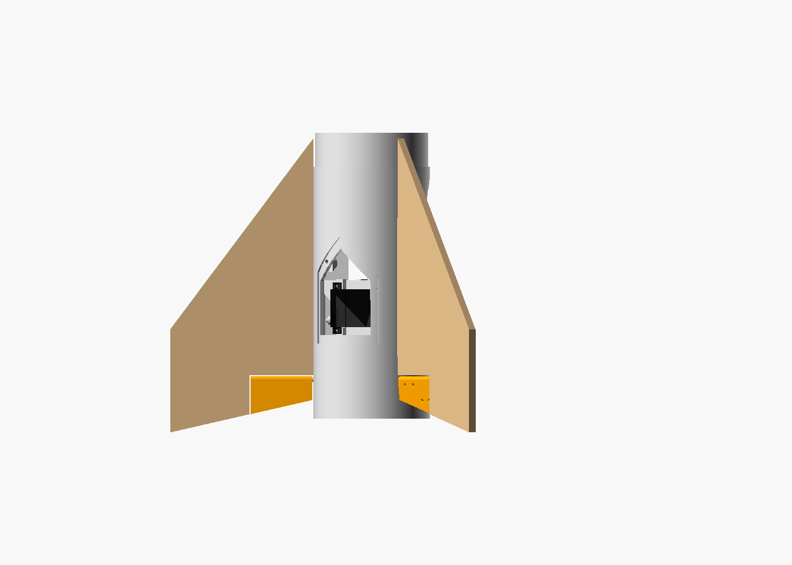

# Zephyr tail steering: a Mach 0.8 build

This is a clean build of the Apogee Zephyr (kit 04997), not yet built, flown with the camera
nose and CATS Vega. It uses the Peregrine's tail steering: each of three fixed fins carries a
trailing-edge aileron on a steel shaft, with a printed PC fin can holding the hinges, servos
and LiPo. It is sized for Mach 0.8.

All of it is generated from the same `PeregrineTailSteer.scad` with `Airframe = "Zephyr"`.
The Peregrine parts are unchanged (byte-identical; see Verification).

**Status:** CAD-verified design. Nothing is printed or bench-tested. Every load below is a
hand estimate, marked for confirmation against the Zephyr CFD at Mach 0.25–0.8. That study
runs the earlier `Fin_Set = "Zephyr"` ailerons on the kit fin, so its hinge moments and
Cl_δ need scaling to this aileron and fin.




## What changes for Mach 0.8

| | Peregrine (164 m/s design) | Zephyr (Mach 0.8) |
|---|---|---|
| Design point | q 10.8 kPa (J350, 132.7 m/s), no compressibility | q 45.4 kPa at M 0.80 (272 m/s), loads × 1.67 (Prandtl–Glauert), so 75.7 kPa effective |
| Fastest motor with the tail | J350W 119.7 m/s | J510W 263.1 m/s (M 0.78) |
| Motor mount | 38 mm × 279.4 (kit) | 38 mm × 609.6, for 38/1080-class J motors up to 584 mm |
| Fins | 1/4 in birch ply, Peregrine outline | 1/4 in carbon-fibre plate; span 125, tip chord 90, trailing edge swept 12 mm past the base |
| Fixed-fin flutter (TN 4197) | — | 1350 m/s, 5.0× the design speed |
| Aileron | 2623 mm², ±15° | 1282 mm², **±5°** |
| Link ratio (crank / horn) | 14 / 9 = 1.56 | 16 / 8 = 2.00 (servo lash counts half) |
| Roll authority at full travel | Cl 1.09 (0.073 /deg × 15°) | Cl 0.32 (0.064 /deg × 5°) = 29× the fins' own induced roll |
| Factors at the design point (servo / bearing / shaft / horn screw) | 5.7× / 3.4 / 3.1 / 3.8 | 12.1× / 2.8 / 2.5 / 7.1 |
| Cleared to (all factors ≥ 2) | 164 m/s (155 with Prandtl–Glauert) | 288 m/s (M 0.85) with Prandtl–Glauert |
| Canards | On the nose | Removed |
| Tail mass change | +460 g | +877 g against the stock kit fin section |
| Margin at max speed | 2.32 cal | 1.97 cal (OpenRocket, the new fins) |

The can, bearings, shaft, servo, crank design, hatches and wiring stay the Peregrine's. At
±5° the 4 mm shaft and the 684 bearings hold Mach 0.8 with a factor of 2.5 or more, so the
can only needed a new servo angle for the 2.0 link ratio. Shrinking the aileron instead was
not possible: its chord runs from the hinge to the trailing edge, and the hinge (Z 34)
cannot move aft into the motor retainer's keep-out.

## Design choices

- **Motor mount: 38 mm.**
  - With the tail-steering mass, the fastest commercial 38 mm motors reach M 0.72–0.78 in OpenRocket 24.12 (`Zephyr-CamNose.ork` rerun by `tools/ORSimMass.java`, Långtora conditions). That is close to the target and under it:

    | Motor | Length | v max, with the tail | Mach | v max, stock kit fins, no tail |
    |---|---:|---:|---:|---:|
    | AeroTech J510W | 584 mm | 263.1 m/s | 0.78 | 317.5 m/s |
    | Cesaroni 1115J530-15A (Pro38 6XL) | 500 mm | 259.9 m/s | 0.77 | 318.8 m/s |
    | AeroTech J825R (38/1080) | 478 mm | 257.2 m/s | 0.76 | 327.6 m/s |

  - 54 mm J/K motors overshoot: the K630, K650 and K670 reach M 0.98–1.0 in the same model.
  - A 54 mm tube also leaves no room for the hinge. Its bore (r 28.9) takes the inner bearing's place at r 25–29, and the servos then lose their 8 mm air gap.
  - The motor tube is 24 in (609.6 mm) so that the longest pick, the J510W, sits fully inside it.
  - Without the tail mass, the J motors would pass Mach 0.9. The hinge is cleared for this airframe only as built, with the tail steering.
- **Fins: 1/4 in (6.35 mm) carbon-fibre plate** (woven 0/90 epoxy, ~1.5 g/cm³, in-plane shear modulus ~4 GPa assumed).
  - The aileron has to be 6.35 mm thick to hold the Ø4 shaft and the M2 clamp screws. A fixed fin of the same thickness keeps the aileron flush at Mach 0.8 and keeps the can's fin slot.
  - At this thickness, carbon is 19 % lighter than G10 (626 g against 838 g for three fins). That is worth 13 m/s.
  - Plywood fails the flutter rule on this outline (about 370 m/s, 1.4×).
- **Fin outline.** The root chord (228.27) and root LE station (Z 245.03) are the kit's.
  - Span 125 (kit 112.9), tip chord 90, tip LE 167 aft of the root LE. The trailing edge is straight from the root TE to the tip TE, 12 mm past the base.
  - The kit's notched aft extension is gone, and with it the old aileron clip.
  - The larger span keeps 1.97 cal at max speed despite +877 g at the tail. The kit fin with the same mass gives 1.70 cal.
  - The swept TE puts the fixed fin's tip on the ground first: it reaches 12 mm past the base, the ailerons stop 4 mm short of it.
- **Aileron: ±5°, the Peregrine planform rule.** It spans y 0.8–55 and runs from the hinge to the trailing edge, a chord of 17.5–29.8 mm aft of the hinge.
  - The span is fixed by field service: the 54 mm shaft must come out into the cut-out.
  - Authority is 29× the 0.011 target. Travel, not size, sets the hinge loads, so travel is what is limited.
  - The verifier checks ±5°. Set the Vega's command limit and the servo end points to ±5°; nothing stops the linkage mechanically there.
- **Servo and bearings: MKS HV6160 and NSK 684AZZ, as on the Peregrine.**
  - At the design point the servo margin is 12.1×. The bearings' C0r/P is 2.8, and the shaft's factor is 2.5.
  - A Ø5–6 shaft would need a thicker aileron (and fin) for no gain at ±5°.
- **Link ratio 2.0.** Crank 16 mm and horn 8 mm (Peregrine 14 / 9).
  - The servo turns ±10° for ±5° of aileron, so its gear lash counts half at the aileron.
  - The servo sits at 62.2° from its fin (Peregrine 60.4°). The hatch rebates then stay 15.4 mm from a fin face.
- **Fin can: polycarbonate, as the Peregrine.**
  - Loads on the can stay small. The hatch covers see about 23 kPa of suction (Cp −0.3 × the effective q), which is 22 MPa of bending in the 1.6 mm cover (×2) and 25–37 N per M3 insert.
  - Stagnation heating at M 0.78 is about +31 K, for seconds. PC's HDT is about 130 °C.
  - PA-CF would be stiffer but takes up moisture, and nothing here is stiffness-limited.
- **Flutter and buzz.**
  - Fixed fin: NACA TN 4197 gives 1350 m/s, 5.0× the design speed (sea level, G 4 GPa).
  - Aileron: not mass-balanced; very stiff instead. The 30 mm-chord PC panel gives 1617 m/s (TN 4197). The hinge mode is about 1290 Hz with the linkage at 127 N·m/rad (servo holding full torque within 3°, assumed).
  - **Free play < 0.5° at the trailing edge, including the servo gears.**
    - Budget: servo gear lash ÷ 2, plus the two ball links (about 0.07° each with tight new links), plus 0 for the D-flat, dowel and set screw (line-to-line in CAD; the verifier measures 0.00°).
    - That leaves about 0.7° of servo lash. MKS publishes no lash figure for the HV6160.
    - Bench item: with the servo powered at neutral, rock the trailing edge by hand. The total movement at a 30 mm chord must be under 0.26 mm (0.5°).
- **Nose: the camera nose with the canards removed.**
  - That means the canard fin set, servo cassette, 4 servos, servo pack, switch, saddle and cell keeper: 400.8 g, leaving a 920 g nose.
  - The canards reverse roll control (CFD). They are printed PETG, and at Mach 0.8 they would be the weakest, flutter-prone surfaces. Ahead of the CG they also cost margin.
  - Print the plain (non-canard) shoulder and bottom slice; the OpenRocket model keeps the canard-version masses as proxies.

## Layout and stations

Frame: Z = 0 at the base, +Z forward; x from the nose tip = 1397.68 − Z. Fins are at 0/120/240° and the rail buttons at 60°, as on the Peregrine.

| Item | Where |
|---|---|
| Printed PC can (`FinCan.stl`) | Z 0–220 (x 1177.7–1397.7), 30 mm shoulder into the tube |
| Paper aft tube | The forward 237.2 mm of the kit's slotted AT-98/18 tube (x 940.5–1177.7). The 220 mm cut off its aft end carries all the kit slots |
| Kit coupler (AC-98, 203.2) | At the joint with the forward AT-98/18 tube (x 940.5), glued as the kit |
| Fixed fins | 1/4 in carbon plate to `FixedFin_Zephyr.dxf`. Through-the-wall tab Z 55–175 glued to the motor tube; root LE at Z 245.0 (x 1152.65, the drawing's station) |
| Ailerons | Peregrine design, 1282 mm² each; hinge radial at Z 34; ±5° |
| Motor tube | 38 mm × 609.6, aft end Z 12.7 (as the kit), forward end Z 622.3 (x 775.4) |
| Forward seal | Kit ring with the eyebolt at Z 251 (x 1146.7): gas seal and shock-cord anchor |
| Motor-tube top | The kit's second ring at Z 616–622 (x 775–782), carrying the tube's forward end; the wire pass is potted |
| Rail buttons | Kit stations: aft on the can (Z 53.98, x 1343.7) in an RX-M4x8.1 boss; forward on the paper tube (x 1045.3) with the kit weld nut |
| Recovery bay | x 483 (nose shoulder end) to 775 (motor-tube top), about 290 mm (192 mm clear of the 100 mm nose shoulder) |

## Parts to print

All the files are in this folder. Print settings are as for the Peregrine (`../PeregrineTailSteer/README.md`, Parts to print; PC per `L2-PrintSettings.md`).

`FinCan.stl`, `HatchServo.stl`, `HatchServoLipo.stl` and `Crank.stl` differ from the Peregrine's (servo at 62.2°, 16 mm crank), so use these. `BearingCoupon.stl` and `ShaftDrillJig.stl` also come from the Zephyr render. `AileronScrewHalf_Zephyr.stl` and `AileronTappedHalf_Zephyr.stl`: 3 each. `FixedFin_Zephyr.dxf`: 3 off in 1/4 in carbon plate (waterjet or CNC).

## Checks (hand estimates; confirm against the CFD)

Run `tools/tailsteer_estimate.py --airframe Zephyr`.

### Roll authority
- |Cl_δ| = 0.064 /deg; at ±5°, Cl 0.32 = 29× the fins' induced roll at 4° (0.011).
- Strip theory with thin-airfoil flap effectiveness × 0.85, scaled to the CFD kit-fin CN_α × 1.171. The 1.171 is the Barrowman ratio of the 125 mm fin to the kit fin.
- The CFD study runs the kit fin with the earlier aileron. Its aileron Cl_δ and hinge moments, scaled by area and chord², replace these numbers when they come in.

### Hinge moment, servo, bearings, shaft (at 75.7 kPa effective: q 45.4 kPa × 1.67)

| Case | Hinge | Servo (÷ 2.0) | Aileron force | Factors |
|---|---|---|---|---|
| 5°, α 4° | 0.217 N·m | 0.109 N·m | 26.0 N | — |
| 5°, α 6° (sizing) | 0.234 N·m | 0.117 N·m | 27.7 N at r 81.5 | servo 12.1× (6.0 V), bearing C0r/P 2.8 (outer 80.9 N), shaft 2.5 (179 MPa), horn screw 7.1 |

- **Envelope:** all factors ≥ 2 up to 288 m/s (M 0.85) at sea level with Prandtl–Glauert. At the J510W's 263.1 m/s the factors are servo 13.7×, bearing 3.1, shaft 2.8, horn screw 8.0.
- **Crank and horn:** in flight the pushrod carries 15 N and every crank part has a factor of 22 or more. At servo stall into a jammed aileron, the horn's M2 × 10 12.9 pivot screw yields first, at 0.83 N·m of servo torque.
- **Aileron drive:** the dowel's bearing pressure in the PC is ×17.8 in flight and ×2.5 when the horn screw yields.
- **Landing:** the 4 mm annealed silver-steel shaft yields at about 70 N on the aileron, as on the Peregrine; it is the fuse.
- **Fin root:** at α 6° the fin normal force is about 520 N, and the root bending about 23 N·m. That is about 15 MPa in the carbon root and is carried by the 120 mm tab glued to the motor tube plus the root fillets.

### Mass, CG and stability

New aft section, Z above the base (carbon 1.5 g/cm³, PC 1.20 g/cm³ solid; the can, covers and cranks weighed from their meshes):

| Item | Mass | Z |
|---|---:|---:|
| FinCan | 339.0 g | 108.8 |
| Hatch covers ×3 | 33.0 g | 113.4 |
| Cranks ×3 | 8.1 g | 33.3 |
| Ailerons ×3 | 30.6 g | 23.5 |
| Fixed fins ×3, carbon (notched, with tab) | 626.5 g | 97.9 |
| Shafts, bearings | 22.1 g | 34 |
| Servos ×3 | 92.1 g | 96.5 |
| Links, LiPo, switch/fuse/harness, inserts (est.) | 76.0 g | — |
| Paper tube 237.2 mm | 106.5 g | 338.6 |
| Motor tube 38 × 609.6 | 120.4 g | 317.5 |
| Kit rings ×2 + eyebolt | 83.5 g | — |
| Rail buttons | 3.8 g | 200 |
| **Total** | **1541.5 g** | **149.2** |

- **Against the stock kit fin section:** the kit's tube, plywood fins with tabs, motor tube, rings, eyebolt and buttons come to 664.6 g at Z 141.1. Epoxy and paint are left out of both.
- **Change:** +877 g, applied in OpenRocket as one mass of 0.877 kg at x 1.2423 m (folded into the stage mass override), together with the new fin outline (`tailsteer_estimate.py --fins-csv`).
- **Stability, OpenRocket** (`Zephyr-CamNose.ork`, J510W, new fins and mass):

  | State | Margin |
  |---|---|
  | Max speed (263 m/s) | **1.97 cal** (CG 0.899, CP 1.099 m) |
  | Rod exit, 1.2 m rod, 3 m/s wind | 0.93 cal |
  | Rod exit, 8 ft rail | 1.09 cal |

  - The fin recheck: with the same mass, the kit fin gives 1.70 cal (CP 1.071 m at 264 m/s); the new fin (19892 mm² against 19200) puts the CP 28 mm further aft, for 1.97 cal. The kit-outline concern (the 643 mm² the old aileron clip removed) no longer applies: this outline has no clip, and OpenRocket flies the fixed fin and aileron as one outline (the 0.8 mm gaps closed), not as two fin sets.
  - The CFD CP of the kit-fin Zephyr is 1.059 m at M 0.25, 2.4 cm ahead of OpenRocket's.
- **Mass uncertainty:** the stage mass is the RockSim file's known mass (1.096 kg kit) with the nose swapped. OpenRocket's own component sum is 402 g heavier at almost the same CG, which would mean slower flights and about the same margin.

## Wiring and separation joints

One separation joint: nose shoulder / forward tube at x 483.3. The Vega fires the nose charge at apogee; the motor delay, where the motor has one, is a backup. Everything aft of the nose is glued: the coupler joint at x 940.5, the can shoulder at x 1177.7, and both rings.

| Station (mm from tip) | Joint | Opens | Crossing |
|---|---|---|---|
| 483.3 | Nose shoulder / forward tube | At apogee: the Vega's nose charge | Potted pass through the nose bulkhead, then a pull-apart JST RCY pair just aft of it, with Kevlar lanyards to each side |
| 775–782 | Kit ring at the motor-tube top | — | Potted pass |
| 940.5 | Forward tube / aft tube (kit coupler) | Never (glued) | None. Tape the pair to the tube wall |
| 1146.7 | Kit ring with the eyebolt (gas seal) | — | Potted pass into the can annulus |

- **Cable:** about 1.0 m of 26 AWG silicone twisted pair (signal + ground), taped along the tube wall in the recovery bay.
- **Power, switch, fuse and capacitor:** as the Peregrine.
- **Firmware:**
  - Limit commands to ±5°.
  - Centre the ailerons before the apogee charge; after the connector parts the servos see no pulses.
- **Recovery:** the kit's 36 in parachute lands 3.1 kg at about 10 m/s. Use a 60 in (1.5 m) parachute (about 6 m/s). Apogee on the J510W is 1.56 km in the model, so expect long drift on a single deployment.

## Build order from the bare kit

1. Print `BearingCoupon.stl` and check the bearing seats, the shaft through the wall and the crank, as for the Peregrine.
2. Print the can, hatches, cranks and aileron halves from this folder. Fit the inserts: 7 × RX-M3x5.7, 1 × RX-M4x8.1, 3 × RX-M3x4.0 SHORT.
3. **Tubes.**
   - Cut 220 mm off the aft end of the kit's slotted aft tube. The cut-off piece, which carries all the slots, is scrap.
   - **Check the can shoulder (OD 98.4) in this tube and the can's 101.5 OD against it.** These figures were measured on the Peregrine's tube. Sand the shoulder for a slip fit if needed.
   - Leave the kit motor tube, its aft ring and the spacer rails out. Kit fins: not used.
4. Cut three fins from 1/4 in carbon plate to `FixedFin_Zephyr.dxf`. Round the leading and tip edges to about R1.5.
5. **Shafts:** three Ø4 h9 silver-steel rods, 54.0 mm, with a 0.5 mm D-flat. Drill the Ø2 cross hole in `ShaftDrillJig.stl`.
6. **Bearings and cranks:** as for the Peregrine (Loctite 641; Ø2 × 10 dowel; crank arm toward the servo).
7. **Motor tube:** a 38 mm × 609.6 mm tube (24 in). Epoxy it into the can bore, aft end 12.7 mm above the base.
8. **Fins:** tabs through the slots onto the motor tube.
   - Root fillets: leg at most 10 mm (the hatch rebates are 15.4 mm away), and stop 5 mm forward of the aileron cut-out (Z ≥ 43).
   - Swing the aileron through ±5° loosely before the epoxy cures.
9. **Shafts and ailerons:** as for the Peregrine (dowel, halves, 0.8 mm root shim, then the crank set screw).
10. **Switch:** sector B, as for the Peregrine.
11. **Forward end of the can.**
    - Run the signal pair through the eyebolt ring and pot it.
    - Epoxy the ring onto the motor tube at Z 251–257.4. Tie the shock cord to the eyebolt.
    - Glue the 237.2 mm tube piece over the shoulder and the ring.
    - Fillet the fin roots Z 220–245 onto the paper.
12. **Upper end.**
    - Glue the kit coupler into the tube piece's forward end as the kit does (half out).
    - Epoxy the kit's second ring onto the motor tube's forward end (Z 616–622), with the signal pair potted through it.
    - Slide the forward kit tube over ring and coupler and glue it.
13. **Servos.**
    - Centre each servo at 1520 µs.
    - Drill the metal arm Ø2.1 at **8 mm** from the spline. Fit the pivot (M2 × 10 12.9, 0.3 shim, ball, nut on the case side).
    - Fit the lug bolts. Set each pushrod to 52 mm between ball centres.
    - Program the end points to ±10° of servo (±5° of aileron) if the programmer allows.
14. **Wiring and LiPo:** in sector A, as for the Peregrine. The nose-joint connector gets its lanyards.
15. **Rail buttons:** the aft one in the can's insert, the forward one with the kit weld nut at x 1045.3. **Retainer:** AeroPack RA38L on the motor tube's aft end.
16. **Bench:**
    - Free play under 0.5° at the trailing edge, with the servo powered.
    - Servo sign, 3.3 V signal, behaviour without pulses.
    - Fly from an **8 ft (2.44 m) or longer rail**.

## Hardware (differences from the Peregrine list)

| Item | Qty | Use |
|---|---:|---|
| 1/4 in (6.35 mm) woven carbon-fibre plate | ~3 × 260 × 160 mm | Fixed fins (instead of birch ply) |
| 38 mm motor tube, 609.6 mm (24 in) | 1 | Motor mount (instead of the kit's 279.4) |
| Kit's second ring 38/98 | 1 | Motor-tube top (the kit part, reused) |
| JST RCY pair + Kevlar | 1 (not 2) | Only the nose joint separates |
| 26 AWG twisted pair | ~1.0 m | Vega to the tail |
| 60 in parachute | 1 | Replaces the kit's 36 in |
| Motors | — | AeroTech J510W, Cesaroni 1115J530-15A, AeroTech J825R (and their 38 mm hardware) |

Unchanged from the Peregrine list:
- NSK 684AZZ ×6, Ø4 silver steel, MKS HV6160 ×3, ball links;
- Ø2 × 10 and Ø2 × 14 dowels, M2 × 5 clamp screws, the M2 × 10 12.9 horn pivot;
- inserts and screws, Tattu 450 mAh 2S, Schurter switch, fuse, capacitor;
- AeroPack RA38L.

The kit's plastic nose cone, spacer rails and fins are not used.

## Concerns and items to confirm

- **CFD.** The hinge moments, aileron Cl_δ and fin loads are thin-airfoil estimates × 1.67 for compressibility. The running Zephyr CFD (M 0.25–0.8, kit fin, earlier aileron) gives real numbers, and the freestream Mach at which the flow first goes locally sonic. If that is below 0.78, the design point moves down.
- **Rod exit margin:** 0.93 cal on a 1.2 m rod in 3 m/s wind, and 1.09 on 8 ft. If the wind is above 3 m/s, add 150 g of nose ballast: rod exit then rises to 1.40, for 8 m/s less top speed.
- **Mach 0.78, not 0.8.** No commercial 38 mm motor gets the built rocket to 0.8. A lighter tail would: each 100 g is about 6.5 m/s. The hinge is cleared to M 0.85.
- **Tail mass +877 g.** The carbon fins are 626 g of it.
- **Servo lash** is unpublished. The bench check decides; at a 2.0 ratio, up to about 0.7° at the servo still meets 0.5° at the aileron.
- **No mechanical stop at ±5°.** A runaway servo can drive the aileron past the sized travel. The servo end points and the firmware limit are the protection.
- **Drift:** single deployment at apogee from about 1.5 km.

## Verification

```
~/.cache/camnose-venv/bin/python -I tools/verify_tailsteer.py --export          # both airframes; exports only if every check passes
~/.cache/camnose-venv/bin/python -I tools/tailsteer_estimate.py --airframe Zephyr
java -Djava.awt.headless=true -cp OpenRocket-24.12.jar tools/ORSimMass.java Zephyr-CamNose.ork 0.877 1.2423 --fins FINS.csv
```

`verification.json` holds the last Zephyr run: 66/66 passed (132/132 with the Peregrine's). The checks are those of the Peregrine (every part a closed supportless solid, clearances, walls, bearings, clamp screws, play, fillet room, air gaps, rail, servo and LiPo lift-out, shaft extraction with the fins glued, travel with the linkage solved, gaps over the travel, tail-first landing), run on the Zephyr render. Measured:
- aileron-to-can and aileron-to-fin gaps 0.8 mm;
- horn nut to can 0.65 mm;
- pushrod links to can 3.3 mm;
- fins 18 mm off the rail;
- fixed fin 12 mm past the base, with the ailerons 15.9 mm short of it.

OpenRocket: `Zephyr-CamNose.ork` in MyLevel1Peregrine (PR #46) is the kit with the camera nose, canards removed, 43 motors. The tail-steering change is applied by `ORSimMass.java` with `--fins`.
